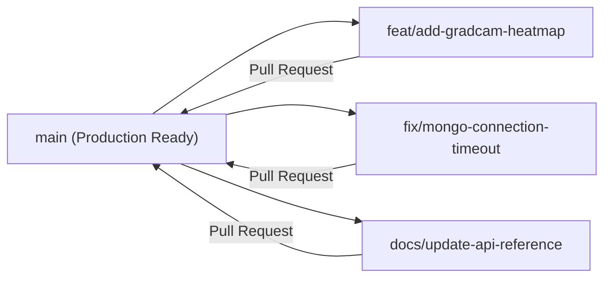

# 🤝 Contributing to Skin Disease Detection Platform

Thank you for your interest in contributing to the **Skin Disease Detection Platform**! We welcome contributions from researchers, machine learning engineers, frontend developers, and healthcare AI enthusiasts.

Please review this guide before submitting issues or opening pull requests to ensure a smooth collaboration process.

---

## 🧭 Code of Conduct

All contributors and maintainers are expected to adhere to our [Code of Conduct](CODE_OF_CONDUCT.md). Please treat everyone in the community with respect, professionalism, and constructive feedback.

---

## 🛠️ Development Workflow & Branching Strategy

We follow the standard GitHub Flow model:



### 1. Branch Naming Conventions
* `feat/<feature-name>` &mdash; New features (e.g. `feat/gradcam-explainability`, `feat/dark-mode-toggle`)
* `fix/<bug-description>` &mdash; Bug fixes (e.g. `fix/model-weights-download-retry`)
* `docs/<topic>` &mdash; Documentation enhancements (e.g. `docs/api-curl-examples`)
* `refactor/<module>` &mdash; Code restructuring without behavior changes

### 2. Step-by-Step Contribution Steps

1. **Fork the repository** on GitHub:
   Click the **Fork** button at the top-right of [Purvesh-PJ/skin_disease_detection](https://github.com/Purvesh-PJ/skin_disease_detection).

2. **Clone your fork locally**:
   ```bash
   git clone https://github.com/<your-username>/skin_disease_detection.git
   cd skin_disease_detection
   ```

3. **Create a descriptive feature branch**:
   ```bash
   git checkout -b feat/your-feature-name
   ```

4. **Set up local development environments**:
   * Refer to the [Local Setup Guide](docs/getting-started/setup-and-installation.md) for configuring Python virtualenv and Node modules.

5. **Commit your changes with conventional commit messages**:
   ```bash
   git commit -m "feat(ml): add test-time augmentation to ensemble inference"
   ```
   *Format*: `type(scope): subject` (Types: `feat`, `fix`, `docs`, `refactor`, `test`, `chore`).

6. **Push to your fork and open a Pull Request**:
   ```bash
   git push origin feat/your-feature-name
   ```

---

## 📐 Code Style & Quality Standards

### Python (Backend & ML)
* **Standard**: Follow [PEP 8](https://peps.python.org/pep-0008/) naming and style guidelines.
* **Docstrings**: Include descriptive docstrings for all new functions, API endpoints, and model layers.
* **Type Hints**: Use Python typing (`str`, `dict`, `list`, `Optional`) where appropriate.

### JavaScript / React (Frontend)
* **Standard**: Functional components with custom React hooks.
* **Clean Code**: Ensure zero unused imports and no unhandled promise rejections in Axios service layers.
* **CSS / Styling**: Maintain responsive design tokens and dark/light theme variable compatibility.

---

## 🧪 Testing Guidelines

Before opening a pull request, verify that your changes do not break existing functionality:

```bash
# 1. Test Backend & API Endpoints
cd backend
python -m unittest discover -s app/tests

# 2. Test ML Prediction Service
python app/tests/test_prediction.py

# 3. Test Frontend Build
cd ../frontend
npm run build
```

---

## 📋 Pull Request Checklist

When submitting a PR, ensure:
- [ ] Feature or fix is tested locally.
- [ ] Relevant documentation in `docs/` has been updated.
- [ ] Commit messages follow the conventional format.
- [ ] No API keys, passwords, or personal secrets are committed.
- [ ] PR description clearly explains the *Why* and *What* of the change.

---

## 💬 Getting Help

If you have questions, feel free to open a [GitHub Discussion](https://github.com/Purvesh-PJ/skin_disease_detection/discussions) or submit an [Issue](https://github.com/Purvesh-PJ/skin_disease_detection/issues).
