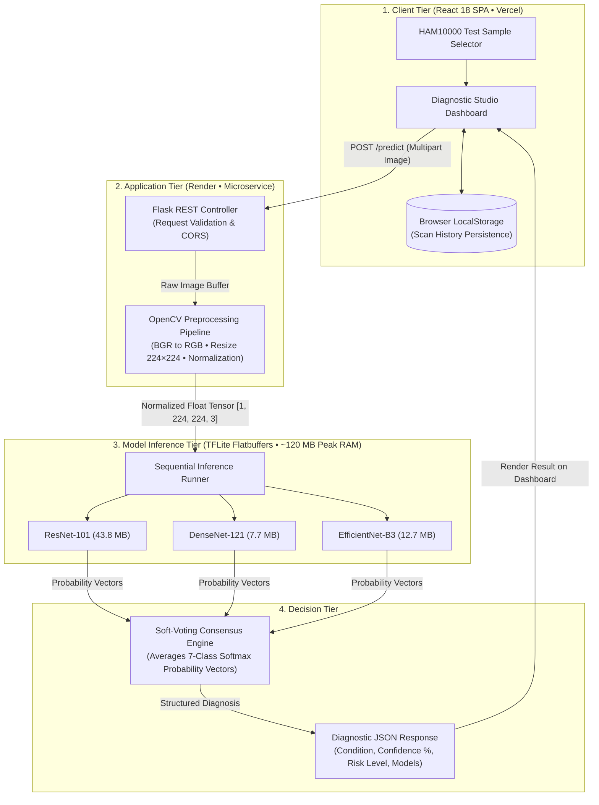

# Skin Disease Detection & Diagnostic Assistant

A full-stack medical computer vision platform that classifies dermatoscopic skin lesions across seven diagnostic conditions using an ensemble of three deep neural networks (**ResNet-101**, **DenseNet-121**, and **EfficientNet-B3**). 

The application is deployed as a high-performance, stateless AI inference microservice: a React 18 single-page application on Vercel, a containerized Flask REST API on Render (<200MB RAM footprint), quantized model checkpoints on Hugging Face Hub, and client-side browser `localStorage` persistence for scan history auditing.

---

## 📸 Preview

<p align="center">
  
</p>

<p align="center">
  
  
</p>

<p align="center">
  
</p>

> **Direct 1-Click Access**: Select **Try Image Detection** or **Launch Diagnostic Studio** on the landing page to run diagnoses immediately with zero login friction.

---

## 🛠️ Tech Stack

| Domain | Technologies | Purpose |
| :--- | :--- | :--- |
| **Frontend** | React 18, React Router v6, Axios | Component-driven single-page application and client routing |
| **UI & Design** | Tailwind CSS v3, Radix UI Primitives, Lucide React | Responsive clinical layout, accessible modals, and iconography |
| **Backend API** | Python 3.12, Flask 3, Gunicorn | Stateless REST inference microservice and request validation |
| **ML Inference** | TensorFlow Lite (`tf.lite.Interpreter`) | Sequential low-memory flatbuffer inference across 3 CNN architectures |
| **Computer Vision** | OpenCV (`opencv-python-headless`), NumPy | Image decode, RGB conversion, and 224×224 tensor normalization |
| **Testing & CI/CD** | pytest, pytest-cov, Jest, GitHub Actions | 63 automated tests, 91% backend coverage, automated CI pipelines |
| **Storage & Persistence**| Browser `localStorage` API | Fast, offline-resilient diagnostic audit logs (up to 50 scans) |
| **Infrastructure** | Docker, Vercel, Render, Hugging Face Hub | Containerization, cloud hosting, automated model checkpoint streaming |

---

## 🧠 Model Architecture & Ensemble Strategy

Individual neural networks often exhibit bias or high variance on dermatoscopic edge cases. To improve diagnostic reliability, this system combines three distinct model architectures trained on the **HAM10000** dataset (10,015 dermatoscopic images across 7 classes):

- **ResNet-101**: Deep residual skip connections that preserve low-level lesion texture and pigment border patterns.
- **DenseNet-121**: Direct layer-to-layer feature reuse that maximizes gradient flow across lesion characteristics.
- **EfficientNet-B3**: Compound scaling of network depth, width, and resolution for fine feature extraction.

### Disease Classes

The ensemble classifies dermatoscopic images into seven target clinical categories:

| Code | Disease Name | Clinical Category | Severity Tier |
| :---: | :--- | :--- | :---: |
| `akiec` | Actinic Keratoses & Intraepithelial Carcinoma | Pre-cancerous / Carcinoma in situ | Pre-Cancerous |
| `bcc` | Basal Cell Carcinoma | Malignant skin cancer | High |
| `bkl` | Benign Keratosis-like Lesions | Benign (Solar lentigines / Seborrheic) | Benign |
| `df` | Dermatofibroma | Benign fibrous histiocytoma | Benign |
| `mel` | Melanoma | Malignant melanocytic tumor | High |
| `nv` | Melanocytic Nevi | Common benign moles | Benign |
| `vasc` | Vascular Lesions | Angiomas, pyogenic granulomas | Moderate |

---

## 🏗️ System Architecture & Data Flow



### Architectural Data Flow

The complete end-to-end lifecycle of an inference request follows these sequential stages:

1. **Client Upload & Preparation**:
   - The user selects, drags, or chooses a curated HAM10000 sample image on the React 18 frontend dashboard.
   - Axios dispatches a `POST /predict` request with a `multipart/form-data` image payload to the Flask backend on Render.

2. **Ingestion & Request Validation**:
   - The Flask route controller intercepts the payload, verifies file presence, and sanitizes the upload filename using Werkzeug's `secure_filename`.
   - The file is temporarily staged in the backend `uploads/` directory with a disk write lock.

3. **Computer Vision Preprocessing (OpenCV)**:
   - OpenCV reads the raw image buffer from disk and validates image integrity.
   - The color space is converted from BGR to RGB (`cv2.COLOR_BGR2RGB`).
   - The image is bicubic-resized to the model target dimensions ($224 \times 224 \times 3$).
   - Pixel intensities are scaled to the normalized float range $[-1.0, 1.0]$ expected by the neural network feature extractors, and expanded into a 4D batch tensor (`shape: [1, 224, 224, 3]`).

4. **Sequential TFLite Inference Execution**:
   - To eliminate Out-of-Memory (`SIGKILL 137`) risks under Render's 512 MB cgroup memory limit, inference executes sequentially across all three models:
     - **ResNet-101** interpreter allocates tensors, evaluates the normalized array, returns its 7-class probability vector, and de-allocates.
     - **DenseNet-121** interpreter executes with intermediate garbage collection (`gc.collect()`).
     - **EfficientNet-B3** interpreter executes the third forward pass.
   - Peak memory consumption remains strictly contained below ~120 MB.

5. **Soft-Voting Ensemble Consensus**:
   - The prediction service aggregates all three 7-class softmax probability vectors by computing their element-wise mean:
     $$\bar{P}(c) = \frac{1}{3} \sum_{m=1}^{3} P_m(c)$$
   - The index with the highest average probability determines the final `predicted_disease` code.
   - Diagnostic metadata is enriched with user-friendly clinical names, risk severity tiers (High, Moderate, Pre-Cancerous, Benign), and contributing ensemble model lists.

6. **History Persistence & Ephemeral Cleanup**:
   - The client stores the diagnostic result directly into browser `localStorage` for instant, private scan auditing (capped at 50 records).
   - The temporary staging file is deleted from `uploads/` in a `finally` block, ensuring zero residual storage leaks on the server.

---

## 🔌 API Endpoints

| Method | Endpoint | Auth | Description / Request Body |
| :--- | :--- | :---: | :--- |
| `GET` | `/` | None | Service liveness probe, environment, and API status |
| `GET` | `/health` | None | Detailed health status, memory diagnostics, and model availability |
| `POST` | `/predict` | None | Upload lesion image (`multipart/form-data`) for ensemble prediction |

---

## 📁 Folder Structure

```text
skin_disease_detection/
├── .github/
│   └── workflows/
│       └── ci.yml              # GitHub Actions automated test & build CI workflow
├── backend/
│   ├── app/
│   │   ├── core/               # Configuration, constants & domain exceptions
│   │   ├── inference/          # Cloud model downloader and TFLite inference engine
│   │   ├── routes/             # REST endpoints (health, predict)
│   │   └── services/           # Prediction service and image preprocessing
│   ├── tests/
│   │   ├── unit/               # Unit tests for preprocessing, ensemble & downloader
│   │   └── integration/        # Integration tests for /health and /predict endpoints
│   ├── Dockerfile              # Production multi-stage Docker build
│   ├── main.py                 # Flask application factory and entry point
│   ├── requirements.txt        # Production Python dependencies
│   ├── requirements-dev.txt    # Testing dependencies (pytest, pytest-cov, pytest-mock)
│   └── pytest.ini              # Pytest test discovery & execution configuration
├── frontend/
│   ├── public/                 # Static assets, icons and application screenshots
│   ├── src/
│   │   ├── components/         # Reusable UI components (Navbar, Modals, Cards, UI)
│   │   ├── context/            # Theme context provider
│   │   ├── pages/              # Landing, Dashboard & 404 pages
│   │   ├── services/           # Axios API client and localStorage history service
│   │   ├── __tests__/          # Frontend Unit & Integration test suites
│   │   ├── App.js              # Application routing & layout tree
│   │   └── index.css           # Tailwind CSS directives and global theme tokens
│   └── package.json            # Frontend dependencies and npm scripts
├── ml_engine/
│   ├── architectures/          # Model architecture definitions (ResNet, DenseNet, EfficientNet)
│   ├── data/                   # HAM10000 dataset loading, cleaning & augmentation pipeline
│   ├── notebooks/              # Jupyter notebooks for EDA and model training experiments
│   └── train.py                # Standalone training script for ensemble models
├── scripts/
│   └── run_backend_tests.py    # Smart cross-platform test runner
├── docs/
│   └── adr/                    # Architecture Decision Records
├── package.json                # Root cross-platform unified test & coverage runner
└── README.md                   # Project documentation
```

---

## ⚙️ Getting Started & Local Setup

### Prerequisites

- **Python**: `3.10+` (Recommended: `3.12` or `3.13`)
- **Node.js**: `18.x+` and `npm`

### 1. Clone Repository

```bash
git clone https://github.com/Purvesh-PJ/skin_disease_detection.git
cd skin_disease_detection
```

### 2. Backend Setup

```bash
cd backend

# Create and activate virtual environment
python -m venv venv
# On Windows:
.\venv\Scripts\activate
# On Linux/macOS:
source venv/bin/activate

# Install production dependencies
pip install -r requirements.txt

# Run API server (automatically downloads checkpoints on first run)
python main.py
```
*API will be available at `http://localhost:5000` (Health check: `http://localhost:5000/health`).*

### 3. Frontend Setup

In a new terminal:

```bash
cd frontend

# Install dependencies
npm install

# Start React development server
npm start
```
*Frontend will open at `http://localhost:3000`.*

### 4. ML Engine: Training, Evaluation & Experimentation

The `ml_engine/` directory houses the complete end-to-end machine learning engineering and research pipeline that trained the HAM10000 ensemble.

#### Core Modules:
- **`data/prepare_dataset.py`**: Automated stratified dataset splitting (80% train, 10% validation, 10% test) across all 7 diagnostic classes (`akiec`, `bcc`, `bkl`, `df`, `mel`, `nv`, `vasc`).
- **`architectures/`**: Transfer-learning backbones fine-tuned for dermatoscopic feature extraction:
  - `resnet.py`: ResNet-101 architecture preserving low-level lesion texture and border asymmetry.
  - `densenet.py`: DenseNet-121 architecture with dense feature concatenation.
  - `efficientnet.py`: EfficientNet-B3 architecture utilizing compound scaling.
- **`pipeline/`**: Training engine and model evaluation:
  - `trainer.py`: Encapsulates training callbacks, early stopping, and model checkpoint saving.
  - `ensemble_model.py`: Trains base models, stacks validation probability vectors, and trains the ensemble meta-model.
- **`notebooks/`**:
  - `01_exploratory_data_analysis.ipynb`: Class distribution, metadata statistics, and image visualization.
  - `02_model_training_and_evaluation.ipynb`: Multi-class confusion matrices, ROC-AUC curves, and classification reports.

#### Running the ML Pipeline Locally:

```bash
cd ml_engine

# 1. Create and activate a dedicated training virtual environment
python -m venv venv_ml
# Windows: .\venv_ml\Scripts\activate  |  Linux/macOS: source venv_ml/bin/activate

# 2. Install ML & Data Science dependencies
pip install -r requirements.txt

# 3. (Optional) Stratify raw Kaggle HAM10000 dataset into train/val/test
python data/prepare_dataset.py --raw_dir path/to/raw_ham10000 --output_dir data/skin_disease_dataset/base_dir

# 4. Option A: Interactive Experiments via Jupyter Notebooks
jupyter notebook notebooks/
# Open 01_exploratory_data_analysis.ipynb or 02_model_training_and_evaluation.ipynb

# 5. Option B: Standalone Full Ensemble Training
python train.py
```

> **TFLite Quantization**: After `.h5` base models are trained, convert them to quantized `.tflite` flatbuffers using TensorFlow Lite for production inference (<200MB RAM footprint).


---

## 🧪 Automated Testing & Coverage

The platform enforces comprehensive full-stack testing across unit and integration layers with unified cross-platform commands.

### Quick Test Execution (Root)

Run all 63 unit and integration tests across backend and frontend in a single command:

```bash
# Run all tests (Backend pytest + Frontend Jest)
npm test

# Run all tests with complete code coverage tables
npm run test:cov
```

### Backend Test Suite (pytest)

The backend features 30 unit and integration tests covering image preprocessing, Google Drive model downloader, real TFLite execution, and Flask API error routing with **91% statement coverage**:

```bash
# Run backend tests
npm run test:backend

# Run backend tests with coverage report
npm run test:backend:cov
```

### Frontend Test Suite (Jest + React Testing Library)

The frontend contains 33 tests across 8 test suites verifying component states, Radix UI dialogs, history local storage persistence, navigation routing, and end-to-end diagnostic studio flows:

```bash
# Run frontend tests (CI mode)
npm run test:frontend

# Run frontend tests with coverage report
npm run test:frontend:cov
```

---

## 🌐 Live Demo

- **Web Application**: [https://skin-disease-detection.vercel.app](https://skin-disease-detection.vercel.app)
- **API Health Endpoint**: [https://skin-disease-detection-6kxm.onrender.com/health](https://skin-disease-detection-6kxm.onrender.com/health)
- **Model Checkpoints**: [Hugging Face Model Hub](https://huggingface.co/purvesh-pj/skin-disease-ensemble)

---

## 📄 License & Medical Disclaimer

- **License**: Distributed under the [MIT License](LICENSE).
- **Disclaimer**: This system is developed for **academic and research demonstration purposes only**. It is not certified by FDA/CE-MDR as a medical diagnostic device and must not replace professional dermatological evaluation or histopathological biopsy.
