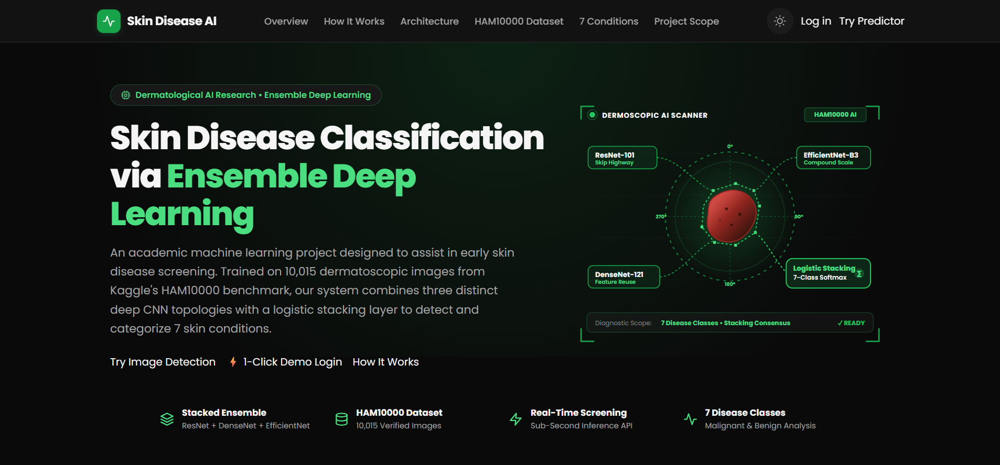
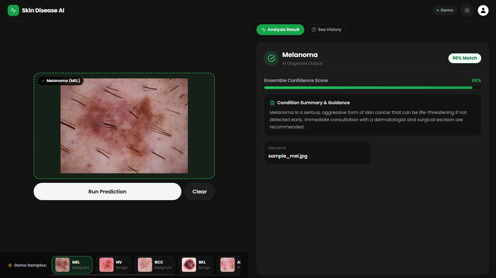
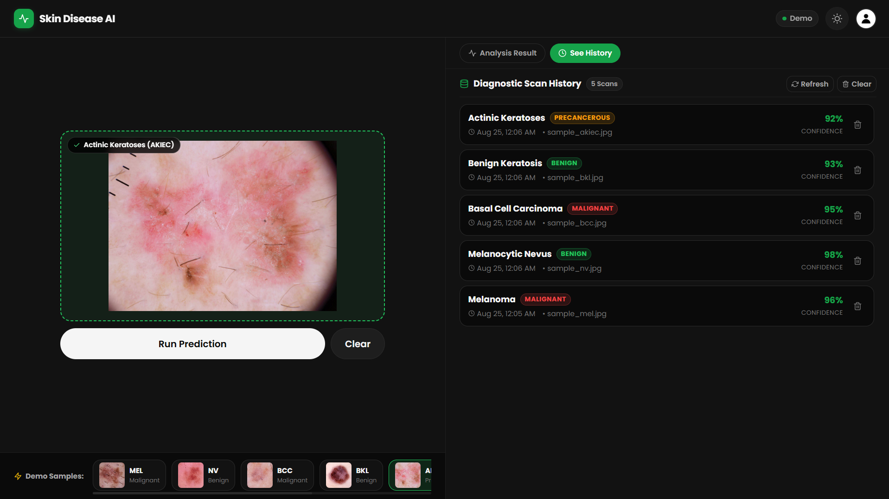
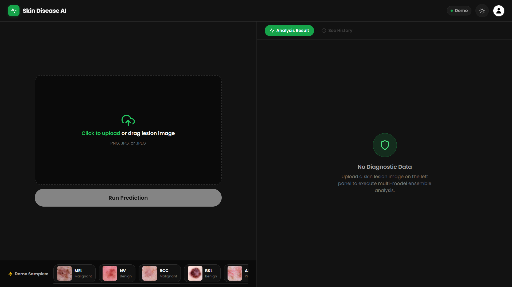
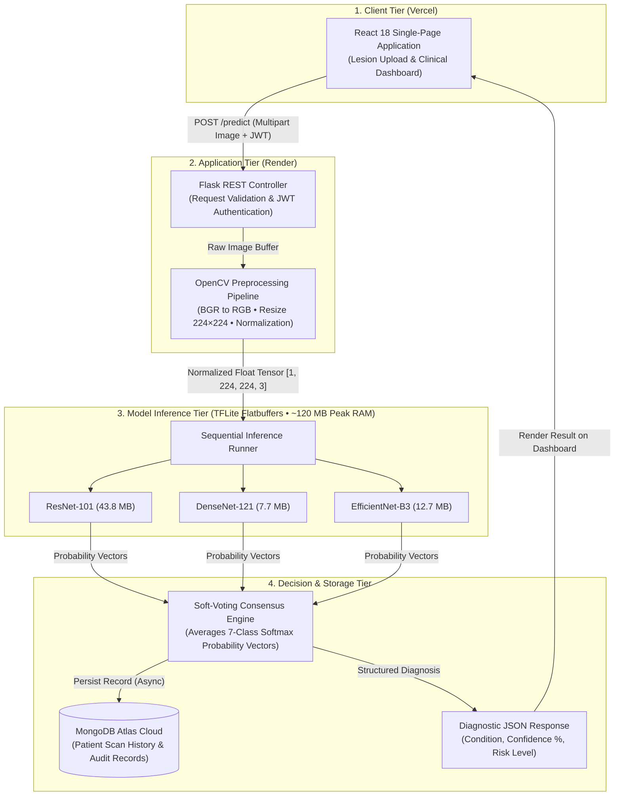

# Skin Disease Detection & Diagnostic Assistant

A full-stack medical computer vision platform that classifies dermatoscopic skin lesions across seven diagnostic conditions using an ensemble of three deep neural networks (**ResNet-101**, **DenseNet-121**, and **EfficientNet-B3**). 

The application is deployed with a React 18 single-page application on Vercel, a containerized Flask REST API on Render, quantized model checkpoints on Hugging Face Hub, and MongoDB Atlas for scan history auditing.

---

## 📸 Preview

<p align="center">
  
</p>

<p align="center">
  
  
</p>

<p align="center">
  
</p>

> **Demo Evaluator Account**: Select **1-Click Demo Login** on the login page, or use:  
> **Email**: `demo@skindisease.ai` | **Password**: `DemoUser@123`

---

## 🛠️ Tech Stack

| Domain | Technologies | Purpose |
| :--- | :--- | :--- |
| **Frontend** | React 18, React Router v6, Axios | Component-driven single-page application and client routing |
| **UI & Design** | Tailwind CSS v3, Radix UI Primitives, Lucide React | Responsive clinical layout, accessible modals, and iconography |
| **Backend API** | Python 3.12, Flask 3, Gunicorn | Production REST server, request validation, and multi-threaded worker |
| **Security & Auth** | Flask-JWT-Extended, Flask-Bcrypt | Stateless JWT authorization and salted password hashing |
| **ML Inference** | TensorFlow Lite (`tf.lite.Interpreter`) | Sequential low-memory flatbuffer inference across 3 CNN architectures |
| **Computer Vision** | OpenCV (`opencv-python-headless`), NumPy | Image decode, RGB conversion, and 224×224 tensor normalization |
| **Database** | MongoDB Atlas, PyMongo | Cloud document persistence for user accounts and scan audit history |
| **Infrastructure** | Docker, Vercel, Render, Hugging Face Hub | Containerization, cloud hosting, automated model checkpoint streaming |

---

## 🧠 Model Architecture & Ensemble Strategy

Individual neural networks often exhibit bias or high variance on dermatoscopic edge cases. To improve diagnostic reliability, this system combines three distinct model architectures trained on the **HAM10000** dataset (10,015 dermatoscopic images across 7 classes):

- **ResNet-101**: Deep residual skip connections that preserve low-level lesion texture and pigment border patterns.
- **DenseNet-121**: Direct layer-to-layer feature reuse that maximizes gradient flow across lesion characteristics.
- **EfficientNet-B3**: Compound scaling of network depth, width, and resolution for fine feature extraction.

### Consensus Strategy (Soft-Voting)
Instead of hard majority voting, the engine averages the softmax probability vectors across all three models:

$$\bar{P}(c) = \frac{1}{3} \sum_{m=1}^{3} P_m(c)$$

The condition with the highest consensus probability becomes the final diagnostic label, penalizing individual model outliers and generating a calibrated confidence score.

### Target Disease Taxonomy

| Code | Disease / Condition | Clinical Classification | Risk Category |
| :--- | :--- | :--- | :--- |
| **`mel`** | Melanoma | Malignant neoplasm of melanocytes | High Risk (Malignant) |
| **`bcc`** | Basal Cell Carcinoma | Common non-melanoma skin cancer | Moderate Risk (Malignant) |
| **`akiec`** | Actinic Keratosis / Bowen's Disease | Squamous intraepithelial carcinoma | Pre-Cancerous |
| **`bkl`** | Benign Keratosis | Seborrheic keratosis, solar lentigo | Benign |
| **`nv`** | Melanocytic Nevus | Common benign mole | Benign |
| **`df`** | Dermatofibroma | Benign fibrous histiocytoma | Benign |
| **`vasc`** | Vascular Lesion | Cherry angioma, pyogenic granuloma | Benign |

### Quantized Checkpoints

Model binaries are converted from heavy Keras `.h5` files into quantized TensorFlow Lite flatbuffers, hosted on [Hugging Face](https://huggingface.co/purvesh-pj/skin-disease-ensemble) and automatically synced on first launch:

| Model Architecture | Format | Checkpoint File | Optimized Size | Size Reduction |
| :--- | :---: | :--- | :---: | :---: |
| **ResNet-101** | TFLite | `resnet101.tflite` | 43.83 MB | −83% |
| **DenseNet-121** | TFLite | `densenet121.tflite` | 7.70 MB | −84% |
| **EfficientNet-B3** | TFLite | `efficientnetb3.tflite` | 12.73 MB | −86% |
| **Total Ensemble** | **TFLite** | **3 Checkpoints** | **~64.26 MB** | **−84%** |

---

## 📐 System Architecture Flow



### Architectural Data Flow

The complete end-to-end lifecycle of an inference request follows these sequential stages:

1. **Client Upload & Auth Context**:
   - The user selects or drops a dermatoscopic lesion image on the React 18 frontend dashboard.
   - The client packages the image into a `multipart/form-data` payload and attaches the user's JWT bearer token (if authenticated) in the `Authorization` header.
   - Axios dispatches a `POST /predict` request to the Flask backend on Render.

2. **Ingestion & Request Validation**:
   - The Flask route controller intercepts the payload, verifies file presence, and sanitizes the upload filename using Werkzeug's `secure_filename`.
   - The file is temporarily staged in the backend `uploads/` directory with a disk write lock.
   - If the request contains a JWT, `get_jwt_identity()` extracts the user's email for session binding.

3. **Computer Vision Preprocessing (OpenCV)**:
   - OpenCV reads the raw image buffer from disk and validates image integrity.
   - The color space is converted from BGR to RGB (`cv2.COLOR_BGR2RGB`).
   - The image is bicubic-resized to the model target dimensions ($224 \times 224 \times 3$).
   - Pixel intensities are scaled to the normalized float range $[-1.0, 1.0]$ expected by the neural network feature extractors, and expanded into a 4D batch tensor (`shape: [1, 224, 224, 3]`).

4. **Sequential TFLite Inference Execution**:
   - To eliminate Out-of-Memory (`SIGKILL 137`) risks under Render's 512 MB cgroup memory limit, inference executes sequentially across all three models:
     - **ResNet-101** interpreter allocates tensors, evaluates the normalized array, returns its 7-class probability vector, and de-allocates.
     - **DenseNet-121** interpreter executes with intermediate garbage collection (`gc.collect()`).
     - **EfficientNet-B3** interpreter executes the third forward pass.
   - Peak memory consumption remains strictly contained below ~120 MB.

5. **Soft-Voting Ensemble Consensus**:
   - The prediction service aggregates all three 7-class softmax probability vectors by computing their element-wise mean:
     $$\bar{P}(c) = \frac{1}{3} \sum_{m=1}^{3} P_m(c)$$
   - The index with the highest average probability determines the final `predicted_disease` code.
   - Diagnostic metadata is enriched with user-friendly clinical names, risk severity tiers (High, Moderate, Pre-Cancerous, Benign), and contributing ensemble model lists.

6. **History Persistence & Audit Logging**:
   - If the user is authenticated, PyMongo asynchronously commits a scan audit document to the `history` collection in MongoDB Atlas (including timestamp, filename, predicted condition, risk level, and confidence percentage).
   - Unauthenticated/guest predictions skip database persistence (`saved_to_db: false`).

7. **Payload Delivery & Ephemeral Cleanup**:
   - The backend cleans up disk storage by immediately unlinking and deleting the temporary uploaded file in a `finally` block to prevent disk space leaks.
   - The Flask API returns a structured `200 OK` JSON response to the React client.
   - The frontend updates the dashboard state in real time, rendering diagnostic confidence gauges, risk warnings, and refreshing the scan history table.

> 📖 **Architecture Decision Records (ADRs)**: Detailed engineering trade-offs, alternative evaluations, and design rationale based on real-world constraints are documented in [docs/adr/](docs/adr/README.md).

---

## ✨ Key Features

- **Multi-Model Soft-Voting Consensus**: Ensemble evaluation across 3 neural networks with granular per-model confidence breakdown.
- **Clinical Risk Assessment**: Classifies conditions into High Risk, Moderate Risk, Pre-Cancerous, and Benign severity tiers.
- **Curated Sample Picker**: Built-in test samples for instant testing without requiring personal clinical images.
- **Patient Scan History & Audit Log**: Persistent MongoDB scan records with timestamp, predicted condition, risk level, and deletion controls.
- **Authentication & 1-Click Demo**: JWT-based session security with bcrypt salted hashing and one-click evaluator login.
- **Responsive Clinical Dashboard**: Built with Tailwind CSS and Radix UI primitives for desktop and mobile screens.

---

## 🔌 API Endpoints

| Method | Endpoint | Auth | Description / Request Body |
| :--- | :--- | :---: | :--- |
| `GET` | `/health` | None | Service liveness probe, environment, and model load status |
| `POST` | `/predict` | Optional | Upload lesion image (`multipart/form-data`) for ensemble prediction |
| `POST` | `/auth/register` | None | Register new user (`name`, `email`, `password`) |
| `POST` | `/auth/login` | None | Authenticate user credentials and return JWT bearer token |
| `POST` | `/auth/demo-login` | None | Provision pre-configured evaluator session token |
| `GET` | `/auth/verify-token` | Bearer JWT | Validate session token and return user profile |
| `GET` | `/auth/profile` | Bearer JWT | Retrieve profile details of authenticated user |
| `PUT` | `/auth/profile` | Bearer JWT | Update user profile data |
| `GET` | `/history` | Bearer JWT | Fetch paginated scan history and prediction metrics (limit: 50) |
| `DELETE` | `/history/<id>` | Bearer JWT | Delete a specific scan record from audit log |
| `DELETE` | `/history/clear` | Bearer JWT | Clear entire scan history for authenticated user |

---

## 📁 Folder Structure

```text
skin_disease_detection/
├── backend/
│   ├── app/
│   │   ├── core/               # Configuration, database connection & custom exceptions
│   │   ├── routes/             # REST endpoints (auth, predict, history)
│   │   ├── services/           # Prediction service, image preprocessing & auth logic
│   │   └── tests/              # Unit tests for preprocessing and prediction flow
│   ├── Dockerfile              # Production multi-stage Docker build
│   ├── download_models.py      # Hugging Face model checkpoint streaming script
│   ├── gunicorn_logger.py      # Custom quiet logger for health check pings
│   ├── main.py                 # Flask application factory and entry point
│   └── requirements.txt        # Backend Python dependencies
├── frontend/
│   ├── public/                 # Static assets, icons and application screenshots
│   ├── src/
│   │   ├── components/         # Reusable UI components (Navbar, Modals, Cards)
│   │   ├── context/            # Global authentication & application state
│   │   ├── pages/              # Landing, Dashboard, Login, Signup & 404 pages
│   │   ├── services/           # Axios API client and request interceptors
│   │   ├── App.js              # Application routing & layout tree
│   │   └── index.css           # Tailwind CSS directives and global theme tokens
│   └── package.json            # Frontend dependencies and npm scripts
├── ml_engine/
│   ├── architectures/          # Model architecture definitions (ResNet, DenseNet, EfficientNet)
│   ├── data/                   # HAM10000 dataset loading, cleaning & augmentation pipeline
│   ├── notebooks/              # Jupyter notebooks for EDA and model training experiments
│   └── train.py                # Standalone training script for ensemble models
├── docs/
│   └── adr/                    # Architecture Decision Records (Web Pivot, Transfer Learning, Ensemble, TFLite)
├── trained_models/             # Local directory for downloaded .tflite checkpoints
├── docker-compose.yml          # Multi-container orchestration (Backend + Frontend)
└── README.md                   # Project documentation
```

---

## ⚙️ Getting Started & Local Setup

### Prerequisites

- **Python**: `3.10+` (Recommended: `3.12`)
- **Node.js**: `18.x+` and `npm`
- **MongoDB**: MongoDB Atlas connection URI or local instance

### 1. Clone Repository

```bash
git clone https://github.com/Purvesh-PJ/skin_disease_detection.git
cd skin_disease_detection
```

### 2. Backend Setup

```bash
cd backend

# Create and activate virtual environment
python -m venv venv
# On Windows:
.\venv\Scripts\activate
# On Linux/macOS:
source venv/bin/activate

# Install dependencies
pip install -r requirements.txt

# Configure environment variables
cp ../.env.example .env
# Set MONGO_URI and JWT_SECRET_KEY in .env

# Run API server (automatically downloads checkpoints on first run)
python main.py
```
*API will be available at `http://localhost:5000` (Health check: `http://localhost:5000/health`).*

### 3. Frontend Setup

In a new terminal:

```bash
cd frontend

# Install dependencies
npm install

# Start React development server
npm start
```
*Frontend will open at `http://localhost:3000`.*

### 4. ML Engine & Model Training (For ML / Data Science Workflows)

If you want to train models from scratch, experiment with architectures, or run exploratory analysis on the HAM10000 dataset:

```bash
cd ml_engine

# Create dedicated virtual environment for training
python -m venv venv_ml
# Windows: .\venv_ml\Scripts\activate  |  Linux/macOS: source venv_ml/bin/activate

# Install ML dependencies (TensorFlow, Albumentations, Matplotlib, Jupyter, etc.)
pip install -r requirements.txt

# Option A: Interactive Experiments & EDA via Jupyter Notebooks
jupyter notebook notebooks/
# Open 01_exploratory_data_analysis.ipynb or 02_model_training_and_evaluation.ipynb

# Option B: Run Standalone Training Pipeline
python train.py
```

> **Converting Trained `.h5` to `.tflite`**:  
> Once training produces `.h5` model checkpoints, convert them into low-memory flatbuffers for production inference:
> ```bash
> cd ../backend
> python convert_to_tflite.py
> ```

### 5. Docker Compose (Alternative)

To build and run the full stack (Frontend + Backend) in isolated containers:

```bash
docker-compose up --build
```

---

## 🧪 Automated Testing & Coverage

The platform enforces comprehensive full-stack testing across unit and integration layers with unified cross-platform commands.

### Quick Test Execution (Root)

Run all 63 unit and integration tests across backend and frontend in a single command:

`ash
# Run all tests (Backend pytest + Frontend Jest)
npm test

# Run all tests with complete code coverage tables
npm run test:cov
`

### Backend Test Suite (pytest)

The backend features 30 unit and integration tests covering image preprocessing, Google Drive model downloader, real TFLite execution, and Flask API error routing with **91% statement coverage**:

`ash
# Run backend tests
npm run test:backend

# Run backend tests with coverage report
npm run test:backend:cov
`

### Frontend Test Suite (Jest + React Testing Library)

The frontend contains 33 tests across 8 test suites verifying component states, Radix UI dialogs, history local storage persistence, navigation routing, and end-to-end diagnostic studio flows:

`ash
# Run frontend tests (CI mode)
npm run test:frontend

# Run frontend tests with coverage report
npm run test:frontend:cov
`
---

## 🌐 Live Demo

- **Web Application**: [https://skin-disease-detection.vercel.app](https://skin-disease-detection.vercel.app)
- **API Health Endpoint**: [https://skin-disease-detection-6kxm.onrender.com/health](https://skin-disease-detection-6kxm.onrender.com/health)
- **Model Checkpoints**: [Hugging Face Model Hub](https://huggingface.co/purvesh-pj/skin-disease-ensemble)

---

## 📄 License & Medical Disclaimer

- **License**: Distributed under the [MIT License](LICENSE).
- **Disclaimer**: This system is developed for **academic and research demonstration purposes only**. It is not certified by FDA/CE-MDR as a medical diagnostic device and must not replace professional dermatological evaluation or histopathological biopsy.
