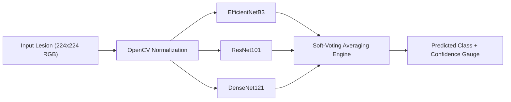

# 🧠 Skin Disease Detection & Classification Platform

<div align="center">

> **An AI-powered dermatological analysis platform leveraging deep convolutional ensemble learning (EfficientNetB3, ResNet101, DenseNet121), scalable Flask microservices, and a modern React 18 clinical interface.**

[](https://www.python.org/)
[](https://react.dev/)
[](https://www.tensorflow.org/)
[](https://www.mongodb.com/)
[](https://www.docker.com/)
[](LICENSE)
[](CONTRIBUTING.md)

[🚀 Live Demo](#-instant-demo-access) • [📖 Documentation Portal](docs/README.md) • [⚡ Quickstart](#-getting-started--quickstart) • [🏛️ Architecture](docs/architecture/system-architecture.md) • [📡 API Reference](docs/api-reference/endpoints.md) • [🤝 Contributing](CONTRIBUTING.md)

</div>

---

## 📸 Visual Showcase & UI Walkthrough

<div align="center">
  
</div>

<br />

| 🔍 **Dermoscopy Scanner & Analysis** | 📊 **Patient History & Audit Logs** |
| :---: | :---: |
|  |  |

| 🌓 **Dark / Light Theme Engine** | 🧪 **1-Click HAM10000 Sample Picker** |
| :---: | :---: |
|  |  |

---

## 📋 Executive Overview

Dermatological conditions and malignant melanomas require early, accurate diagnosis. The **Skin Disease Detection Platform** is an end-to-end Clinical Decision Support (CDS) system that classifies dermoscopy skin lesion images into **7 diagnostic categories** with high confidence.

The platform uses a **heterogeneous deep learning ensemble** combining **EfficientNetB3**, **ResNet101**, and **DenseNet121** trained on the gold-standard **HAM10000 dataset**. Inferences are computed using soft-voting consensus to maximize sensitivity and minimize false negatives in high-risk classes like Melanoma (`mel`) and Basal Cell Carcinoma (`bcc`).

---

## ✨ Key Capabilities & Features

* 🧠 **Tri-Model Deep Learning Ensemble**: Real-time soft-voting consensus across EfficientNetB3, ResNet101, and DenseNet121.
* ⚡ **7-Class Dermatological Triage**: Accurate classification of Melanoma, Basal Cell Carcinoma, Actinic Keratoses, Nevi, and Benign Lesions.
* 🛡️ **Zero-Downtime Fail-Safe Demo**: Built-in instant demo fallback session that circumvents free-tier cloud host cold-starts.
* 🧪 **1-Click Sample Lesions Picker**: Pre-loaded HAM10000 sample images for immediate evaluator testing without uploading local files.
* 🎨 **Modern React 18 Workspace**: Fluid UI with drag-and-drop dropzone, live image preview, risk categorization cards, and dark/light mode context.
* 🔐 **Enterprise Authentication**: Salted Blowfish password hashing via Bcrypt, JWT access control, and profile customization.
* 🗄️ **Persistent Cloud History**: MongoDB Atlas synchronization with optimistic local caching for instant rendering across devices.
* 🐳 **Cloud-Native & Docker Ready**: Multi-stage Dockerfiles and Docker Compose orchestration for one-command deployment.

---

## 🎯 Instant Demo Access

To explore the platform immediately without creating a new account:

* **1-Click Recruiter Demo**: Click the **"1-Click Demo Login"** button on the `/login` page for instant automated access.
* **Pre-configured Demo Credentials**:
  ```yaml
  Email: demo@skindisease.ai
  Password: DemoUser@123
  ```

---

## 🔬 Machine Learning & Dataset Taxonomy



### HAM10000 Disease Classification Classes

| Class Code | Medical Condition | Clinical Summary | Risk Tier |
| :--- | :--- | :--- | :--- |
| **`mel`** | **Melanoma** | Malignant neoplasm of melanocytes; highly aggressive. | 🚨 High Risk (Malignant) |
| **`bcc`** | **Basal Cell Carcinoma** | Common non-melanoma malignant cancer arising from basal cells. | ⚠️ Moderate Risk (Malignant) |
| **`akiec`** | **Actinic Keratoses / IEC** | Pre-cancerous / intraepithelial squamous cell carcinoma. | ⚠️ Pre-Cancerous |
| **`bkl`** | **Benign Keratosis-like Lesions** | Seborrheic keratoses, solar lentigines, and lichen-planus lesions. | 🟢 Benign |
| **`nv`** | **Melanocytic Nevi** | Common benign melanocytic moles. | 🟢 Benign |
| **`df`** | **Dermatofibroma** | Benign fibrous histiocytoma / skin nodule. | 🟢 Benign |
| **`vasc`** | **Vascular Lesions** | Angiomas, cherry angiomas, and pyogenic granulomas. | 🟢 Benign |

### 📥 Pre-Trained Model Weights

Download the pre-trained `.h5` model checkpoints from Google Drive Storage:

🔗 **[Download Pre-Trained Models Archive](https://drive.google.com/file/d/1RdJgiNy94sM2OfU3N6RqFbDBD-BawNYY/view)**

Extract the files into the `trained_models/` directory in your project root:
```
trained_models/
├── densenet121.h5       (~49.2 MB)
├── efficientnetb3.h5    (~90.2 MB)
└── resnet101.h5         (~256.2 MB)
```
*(Note: If `MODEL_ZIP_URL` is set in your `.env`, the backend automatically downloads missing weights on startup).*

---

## 🛠️ Technology Stack Matrix

| Layer | Technologies & Tools |
| :--- | :--- |
| **Frontend Web Client** | React 18, React Router v6, Styled Components, Axios, Radix UI Icons |
| **Backend Gateway** | Python 3.12, Flask, Flask-JWT-Extended, Flask-Bcrypt, Flask-CORS, Gunicorn |
| **Machine Learning & CV** | TensorFlow 2.x, Keras, OpenCV (`opencv-python-headless`), Albumentations, Scikit-Learn |
| **Database & Cache** | MongoDB Atlas / Local MongoDB, PyMongo, Browser `localStorage` Cache |
| **DevOps & Cloud** | Docker, Docker Compose, Nginx Alpine, Vercel (SPA), Render / Railway (API) |

---

## ⚡ Getting Started & Quickstart

### Prerequisites
* **Python**: `3.10+` (Recommended: `3.12`)
* **Node.js**: `18.x+` (Recommended: `20.x LTS`)
* **MongoDB**: Local daemon or [MongoDB Atlas Cloud](https://cloud.mongodb.com) connection string
* **Git**: Installed and configured

---

### 🚀 Rapid Launch (One-Click Windows Launchers)

* **Backend**: Double-click [`run_backend.bat`](run_backend.bat) (Initializes Flask on `localhost:5000`).
* **Frontend**: Double-click [`run_frontend.bat`](run_frontend.bat) (Initializes React on `localhost:3000`).

---

### ⚙️ Manual Step-by-Step Installation

#### 1. Clone the Repository
```bash
git clone https://github.com/Purvesh-PJ/skin_disease_detection.git
cd skin_disease_detection
```

#### 2. Configure Environment
```bash
# Copy environment configuration
cp .env.example .env
```

#### 3. Backend Setup (Flask & Python)
```bash
cd backend
python -m venv venv

# Activate virtual environment
# Windows:
.\venv\Scripts\activate
# macOS / Linux:
# source venv/bin/activate

pip install -r requirements.txt
python main.py
```
> Server initializes at `http://localhost:5000`. Health check: `http://localhost:5000/health`.

#### 4. Frontend Setup (React 18)
```bash
cd ../frontend
npm install
npm start
```
> Web client opens automatically at `http://localhost:3000`.

---

### 🐳 Running with Docker Compose

Run the entire multi-container stack with a single command:

```bash
docker-compose up --build
```
* **Frontend SPA**: `http://localhost:3000`
* **Backend API**: `http://localhost:5000`
* **MongoDB**: `localhost:27017`

---

## 📡 REST API Summary

| Method | Endpoint | Auth | Description |
| :--- | :--- | :---: | :--- |
| `GET` | `/health` | ❌ | Server liveness & readiness check |
| `POST` | `/auth/register` | ❌ | Register new practitioner account |
| `POST` | `/auth/login` | ❌ | Authenticate credentials & receive JWT |
| `POST` | `/auth/demo-login` | ❌ | 1-Click recruiter demo access |
| `GET` | `/auth/profile` | ✅ | Retrieve authenticated profile |
| `POST` | `/predict` | 🟡 | Upload dermoscopy image for ensemble classification |
| `GET` | `/history` | ✅ | Fetch chronological scan audit log |
| `DELETE` | `/history/<id>` | ✅ | Delete specific scan record |

For complete schemas, request/response bodies, and cURL examples, see the [REST API Reference](docs/api-reference/endpoints.md).

---

## 📚 Comprehensive Documentation Portal

Detailed technical documentation is organized in the [`docs/`](docs/README.md) directory:

```
docs/
├── README.md                              # 📖 Master Documentation Hub & Reading Flow
├── getting-started/                       # 🚀 Setup Guide & 5-Minute Quickstart
├── architecture/                          # 🏛️ System Architecture, Frontend SPA & Data Models
├── machine-learning/                      # 🧠 Deep CNN Ensemble Pipeline & Training Guide
├── api-reference/                         # 📡 REST API Endpoints & Request/Response Schemas
├── devops/                                # 🐳 Docker, Deployment (Vercel/Render) & Env Matrix
├── security/                              # 🔒 Security Controls & Medical AI CDS Notices
└── troubleshooting/                       # 🔍 Diagnostic Playbook & Common Error Fixes
```

---

## 🔒 Security & Clinical Decision Support (CDS) Disclaimer

> [!IMPORTANT]
> **Clinical Notice:** This software is developed for **academic, research, educational, and assistive screening demonstration purposes only**. It is **not** an FDA/CE-MDR approved diagnostic medical device and should never replace professional medical judgment or biopsy by certified dermatologists.

* **Authentication Security**: Bcrypt with 12 salt rounds, JWT access tokens with 1-hour expiration.
* **Input Hardening**: 16 MB upload ceiling, `werkzeug.utils.secure_filename` path traversal sanitization, and ephemeral temporary storage cleanup.

---

## 📜 Open-Source Governance & Community

We adhere to standard open-source community health practices:

* ⚖️ **[MIT License](LICENSE)** &mdash; Permissive open-source license.
* 🤝 **[Contributing Guidelines](CONTRIBUTING.md)** &mdash; Branching strategy, testing rules, and PR checklists.
* 📜 **[Code of Conduct](CODE_OF_CONDUCT.md)** &mdash; Contributor Covenant v2.1 standards.
* 🔒 **[Security Policy](SECURITY.md)** &mdash; Vulnerability disclosure and reporting protocols.
* 📋 **[Changelog](CHANGELOG.md)** &mdash; Semantic release history (v1.0.0).

---

## 👤 Author & Acknowledgements

* **Creator & Maintainer**: **Purvesh Patel** ([@Purvesh-PJ](https://github.com/Purvesh-PJ))
* **Dataset Foundation**: [HAM10000 Dataset](https://www.kaggle.com/datasets/kmader/skin-cancer-mnist-ham10000) (ISIC & Tschandl et al.)
* **Frameworks**: [TensorFlow](https://www.tensorflow.org/) • [React](https://react.dev/) • [Flask](https://flask.palletsprojects.com/) • [MongoDB Atlas](https://www.mongodb.com/atlas)

<div align="center">
  <sub>Built with ❤️ for AI Healthcare & Dermatological Research</sub>
</div>
