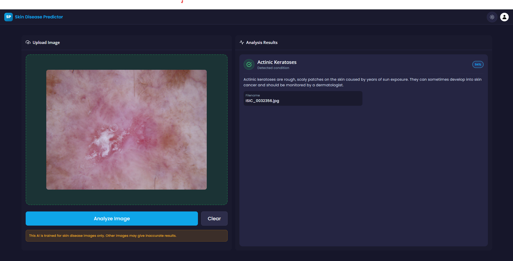

# 🧠 Skin Disease Detection Using Deep Ensemble Learning

<div align="center">

> **A full-stack Computer Vision platform for automated dermatological lesion classification using a 3-CNN Ensemble (EfficientNetB3 + ResNet101 + DenseNet121) on the HAM10000 dataset, powered by a Flask REST API backend and React 18 dashboard.**

[](https://skin-disease-detection.vercel.app/)
[](https://skin-disease-detection-6kxm.onrender.com/health)
[](https://www.python.org/)
[](https://react.dev/)
[](https://www.tensorflow.org/)
[](https://www.mongodb.com/)
[](LICENSE)

[🌐 Live Demo](https://skin-disease-detection.vercel.app/) • [📸 Screenshots](#-screenshots) • [🏛️ Architecture](docs/architecture/system-architecture.md) • [🧠 ML Pipeline](docs/machine-learning/ml-pipeline.md) • [⚡ Quickstart](#-quickstart--local-setup) • [📖 Full Docs](docs/README.md)

</div>

---

## 📌 Project Overview

This project is an end-to-end **Deep Learning & Computer Vision application** built to analyze dermoscopy skin images and classify them into **7 diagnostic disease classes** (including malignant Melanoma and Basal Cell Carcinoma).

### 🔍 Core Problem & Technical Approach
Single CNN models in medical imaging often suffer from high variance and class-specific misclassifications. To solve this, the platform uses a **heterogeneous soft-voting ensemble** combining three deep CNN architectures (**EfficientNetB3**, **ResNet101**, and **DenseNet121**) pre-trained on ImageNet and fine-tuned on the **HAM10000 dataset (10,015 images)**. 

The application provides a complete full-stack workflow: image preprocessing (OpenCV), multi-model inference (TensorFlow/Keras), secure REST APIs (Flask, JWT, Bcrypt), cloud database persistence (MongoDB Atlas), and an interactive clinical dashboard (React 18).

---

## 🌐 Live Deployment & Instant Testing

| Component | Cloud Host | Live URL |
| :--- | :--- | :--- |
| **Frontend Web App** | Vercel | [https://skin-disease-detection.vercel.app/](https://skin-disease-detection.vercel.app/) |
| **Backend REST API** | Render | [https://skin-disease-detection-6kxm.onrender.com](https://skin-disease-detection-6kxm.onrender.com) |
| **Database** | MongoDB Atlas | Managed Cloud Cluster (`skin_disease_db`) |

> 🔑 **1-Click Recruiter Evaluation:**  
> On the login page, click **"1-Click Demo Login"** to bypass registration and access the full clinical scanning dashboard immediately.  
> *(Manual demo credentials: `demo@skindisease.ai` / `DemoUser@123`)*

---

## 📸 Screenshots

<div align="center">
  
</div>

<br />

| 🔍 **Dermoscopy Scanner & Analysis View** | 📊 **Patient History & Audit Log (MongoDB)** |
| :---: | :---: |
|  |  |

| 🌓 **Dark / Light Theme Engine** | 🧪 **1-Click HAM10000 Sample Picker** |
| :---: | :---: |
|  |  |

---

## ⚙️ Engineering Highlights & Technical Architecture

* 🧠 **Heterogeneous Deep Ensemble**: Soft-voting averaging of softmax probability vectors across EfficientNetB3 (compound scaling), ResNet101 (residual skip connections), and DenseNet121 (dense feature reuse).
* ⚡ **Automated Cloud Weights Loader**: Backend automatically lazy-loads and downloads missing `.h5` model checkpoints from remote cloud storage on demand.
* 🛡️ **Cold-Start & Offline Resilience**: Client-side fallback session ensures zero downtime during free-tier cloud host wake-up periods.
* 🧪 **Embedded Sample Dataset Picker**: Direct 1-click access to curated HAM10000 test lesions without requiring users to upload local files.
* 🔐 **Security & Sanitization**: Salted Blowfish password hashing (Bcrypt, 12 rounds), stateless JWT access tokens (HS256), 16 MB upload ceiling, and `secure_filename` path traversal sanitization.
* 🗄️ **Optimistic Data Synchronization**: History service updates client UI instantly while synchronizing records with MongoDB Atlas in the background.

---

## 🔬 Dataset & Classification Taxonomy

Trained and evaluated on the **HAM10000** (*Human Against Machine with 10,000 training images*) dataset:

```
Total Samples: 10,015 dermatoscopic images (RGB, resized to 224x224)
Classes: 7 mutually exclusive dermatological conditions
```

| Class Code | Medical Condition | Clinical Nature | Risk Category |
| :--- | :--- | :--- | :--- |
| **`mel`** | **Melanoma** | Malignant neoplasm of melanocytes | 🚨 High Risk (Malignant) |
| **`bcc`** | **Basal Cell Carcinoma** | Common non-melanoma skin cancer | ⚠️ Moderate Risk (Malignant) |
| **`akiec`** | **Actinic Keratosis / IEC** | Pre-cancerous squamous cell lesion | ⚠️ Pre-Cancerous |
| **`bkl`** | **Benign Keratosis-like Lesions** | Seborrheic keratosis, solar lentigo | 🟢 Benign |
| **`nv`** | **Melanocytic Nevi** | Common benign melanocytic mole | 🟢 Benign |
| **`df`** | **Dermatofibroma** | Benign fibrous skin nodule | 🟢 Benign |
| **`vasc`** | **Vascular Lesions** | Angiomas, pyogenic granulomas | 🟢 Benign |

---

## 🛠️ Technology Stack

| Domain | Technologies & Libraries |
| :--- | :--- |
| **Machine Learning & CV** | TensorFlow 2.x, Keras, OpenCV (`cv2`), Albumentations, NumPy, Scikit-Learn |
| **Backend REST API** | Python 3.12, Flask, Flask-JWT-Extended, Flask-Bcrypt, Flask-CORS, Gunicorn |
| **Frontend SPA** | React 18, React Router v6, Styled Components, Axios, Radix UI Icons |
| **Database & Caching** | MongoDB Atlas Cloud, PyMongo driver, Browser `localStorage` cache |
| **DevOps & Infra** | Docker, Docker Compose, Nginx Alpine, Vercel, Render |

---

## ⚡ Quickstart & Local Setup

### Prerequisites
* Python 3.10+ (Recommended: `3.12`)
* Node.js 18+ & npm
* MongoDB (Local instance or MongoDB Atlas URI)

---

### 1. One-Click Windows Launchers
* **Backend**: Double-click [`run_backend.bat`](run_backend.bat) (Runs Flask server on `localhost:5000`)
* **Frontend**: Double-click [`run_frontend.bat`](run_frontend.bat) (Runs React client on `localhost:3000`)

---

### 2. Manual Step-by-Step Installation

```bash
# 1. Clone the repository
git clone https://github.com/Purvesh-PJ/skin_disease_detection.git
cd skin_disease_detection

# 2. Setup Backend (Terminal 1)
cd backend
python -m venv venv
# Windows: .\venv\Scripts\activate  |  Linux/macOS: source venv/bin/activate
pip install -r requirements.txt
python main.py

# 3. Setup Frontend (Terminal 2)
cd ../frontend
npm install
npm start
```
> The web application opens automatically at `http://localhost:3000`.

---

### 3. Docker Compose
```bash
docker-compose up --build
```
* **Frontend**: `http://localhost:3000` &bull; **Backend API**: `http://localhost:5000` &bull; **MongoDB**: `localhost:27017`

---

## 📥 Model Weights Checkpoints

Pre-trained `.h5` model files can be downloaded from Google Drive:

🔗 **[Download Trained Models Archive (~395 MB)](https://drive.google.com/file/d/1RdJgiNy94sM2OfU3N6RqFbDBD-BawNYY/view)**

Place the `.h5` files inside `trained_models/`:
```
trained_models/
├── densenet121.h5       (~49.2 MB)
├── efficientnetb3.h5    (~90.2 MB)
└── resnet101.h5         (~256.2 MB)
```
*(If `MODEL_ZIP_URL` is set in `.env`, the backend will auto-download missing weights at startup).*

---

## 📡 REST API Endpoints Summary

| Method | Endpoint | Auth | Description |
| :--- | :--- | :---: | :--- |
| `GET` | `/health` | ❌ | Server health & liveness probe |
| `POST` | `/auth/register` | ❌ | User registration with Bcrypt password hashing |
| `POST` | `/auth/login` | ❌ | User authentication & JWT issuance |
| `POST` | `/auth/demo-login` | ❌ | 1-Click recruiter demo auto-provisioning |
| `GET` | `/auth/profile` | ✅ | Fetch authenticated user profile |
| `POST` | `/predict` | 🟡 | Multipart image upload for ensemble classification |
| `GET` | `/history` | ✅ | Fetch user's scan audit history from MongoDB |
| `DELETE` | `/history/<id>` | ✅ | Delete specific scan record |

*For complete request/response schemas and cURL examples, see [REST API Reference](docs/api-reference/endpoints.md).*

---

## 📚 Comprehensive Documentation Hub

Technical documentation is organized in the [`docs/`](docs/README.md) directory:

* 🚀 **[Getting Started](docs/getting-started/setup-and-installation.md)** &bull; [Quickstart](docs/getting-started/quickstart.md)
* 🏛️ **[System Architecture](docs/architecture/system-architecture.md)** &bull; [Frontend SPA](docs/architecture/frontend-architecture.md) &bull; [Data Models](docs/architecture/data-models.md)
* 🧠 **[Machine Learning Pipeline](docs/machine-learning/ml-pipeline.md)** &bull; [Model Training](docs/machine-learning/model-training.md)
* 📡 **[REST API Reference](docs/api-reference/endpoints.md)**
* 🐳 **[DevOps & Deployment Guide](docs/devops/deployment-guide.md)** &bull; [Docker](docs/devops/docker-and-containerization.md) &bull; [Env Matrix](docs/devops/environment-variables.md)
* 🔒 **[Security & Governance](docs/security/security-and-compliance.md)**
* 🔍 **[Troubleshooting Playbook](docs/troubleshooting/diagnostic-playbook.md)**

---

## 🔒 Medical Clinical Decision Support (CDS) Notice

> [!IMPORTANT]
> This software is an engineering research and clinical decision support (CDS) prototype developed for **educational and assistive screening demonstration purposes only**. It is **not** an FDA/CE-MDR certified medical device and must **not** be used as a replacement for clinical diagnosis or tissue biopsy by licensed healthcare professionals.

---

## 📜 Open-Source Governance & Community

* ⚖️ **[MIT License](LICENSE)** &mdash; Permissive open-source license.
* 🤝 **[Contributing Guidelines](CONTRIBUTING.md)** &mdash; Branching strategy, testing rules, and PR checklist.
* 📜 **[Code of Conduct](CODE_OF_CONDUCT.md)** &mdash; Contributor Covenant v2.1.
* 🔒 **[Security Policy](SECURITY.md)** &mdash; Vulnerability reporting procedure.
* 📋 **[Changelog](CHANGELOG.md)** &mdash; Version release notes (v1.0.0).

---

## 👤 Author & Acknowledgements

* **Author & Lead Developer**: **Purvesh Patel** ([@Purvesh-PJ](https://github.com/Purvesh-PJ))
* **Dataset**: [HAM10000 Dataset](https://www.kaggle.com/datasets/kmader/skin-cancer-mnist-ham10000) (ISIC Archive)
* **Frameworks**: [TensorFlow](https://www.tensorflow.org/) • [React](https://react.dev/) • [Flask](https://flask.palletsprojects.com/) • [MongoDB Atlas](https://www.mongodb.com/atlas)
