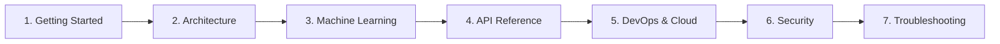

# 🏥 Skin Disease Detection Platform — Documentation Hub

> **An AI-powered dermatological analysis system utilizing deep convolutional ensemble learning, modern React frontend architecture, scalable Flask microservices, and cloud MongoDB Atlas.**

---

## 📌 Executive Summary

The **Skin Disease Detection Platform** is an end-to-end clinical decision support (CDS) application designed to assist medical practitioners, researchers, and users in analyzing dermoscopic skin lesion images. By leveraging an ensemble of three state-of-the-art Deep Convolutional Neural Networks (**EfficientNetB3**, **ResNet101**, and **DenseNet121**), the platform classifies skin lesions into 7 distinct dermatological conditions with high diagnostic confidence.

---

## 🧭 Documentation Map & Sequential Reading Guide



### 1. 🚀 Getting Started
* 🛠️ **[Local Setup & Installation](getting-started/setup-and-installation.md)** &mdash; Full environment setup for Python 3.12, Node.js, and MongoDB.
* ⚡ **[5-Minute Quickstart](getting-started/quickstart.md)** &mdash; Rapid local spin-up and 1-click verification.

### 2. 🏛️ Architecture & Design
* 📐 **[System Architecture](architecture/system-architecture.md)** &mdash; End-to-end multi-tier design, component breakdown, and sequence flows.
* 🎨 **[Frontend Architecture](architecture/frontend-architecture.md)** &mdash; React 18 SPA, component hierarchy, custom hooks, and state management.
* 🗄️ **[Database & Data Models](architecture/data-models.md)** &mdash; MongoDB collections (`users`, `prediction_history`), schema definitions, and caching.

### 3. 🧠 Machine Learning Engine
* 🔬 **[ML Ensemble Pipeline](machine-learning/ml-pipeline.md)** &mdash; HAM10000 dataset taxonomy, CNN architectures, soft-voting formulas, and cloud weights loader.
* 🏋️ **[Model Training Guide](machine-learning/model-training.md)** &mdash; Jupyter notebooks, data splitting, augmentation, and hyperparameter tuning.

### 4. 📡 REST API Reference
* 📋 **[Endpoints & Network Contracts](api-reference/endpoints.md)** &mdash; Complete REST API specifications, request/response JSON schemas, and cURL examples.

### 5. 🐳 DevOps & Deployment
* 🚀 **[Production Deployment](devops/deployment-guide.md)** &mdash; Deployment recipes for Vercel, Render/Railway, and MongoDB Atlas.
* 📦 **[Docker & Containerization](devops/docker-and-containerization.md)** &mdash; Dockerfiles and Docker Compose multi-container stack.
* 🔐 **[Environment Variables](devops/environment-variables.md)** &mdash; Centralized reference matrix for all configuration variables.

### 6. 🔒 Security & Governance
* 🛡️ **[Security & Compliance](security/security-and-compliance.md)** &mdash; Bcrypt hashing, JWT lifecycle, upload sanitization, and Clinical Decision Support (CDS) notices.

### 7. 🔍 Diagnostics & Playbooks
* 🛠️ **[Troubleshooting Playbook](troubleshooting/diagnostic-playbook.md)** &mdash; Symptom-cause-solution playbooks, model weight errors, and connection fixes.

---

## 🧰 Technology Matrix

```
Client Tier:      React 18, React Router v6, Styled Components, Axios
Gateway Tier:     Python 3.12, Flask, Flask-JWT-Extended, Flask-Bcrypt, Flask-CORS
ML Inference:     TensorFlow 2.x, Keras (EfficientNetB3, ResNet101, DenseNet121), OpenCV
Database Tier:    MongoDB Atlas / Local MongoDB (PyMongo)
DevOps Tier:      Docker, Docker Compose, Nginx, Vercel, Render, Railway
```

---

## 🛡️ Clinical Decision Support (CDS) Notice

> [!IMPORTANT]
> This software is engineered for educational, research, and assistive screening demonstration purposes. It is **not** a certified medical diagnostic device and does **not** replace the clinical judgment of certified dermatologists.
