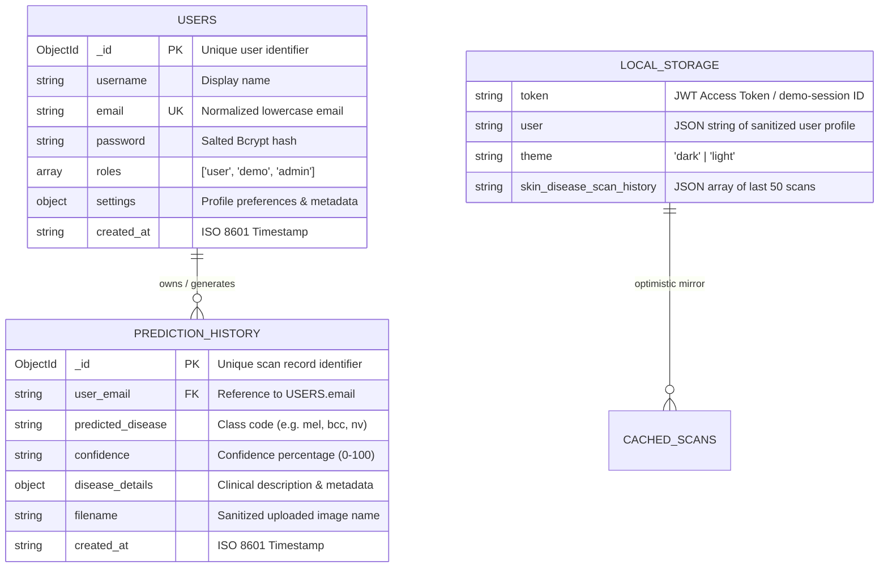

# 🗄️ Database Schemas & Data Models

> **Comprehensive specifications for MongoDB collections, field types, indexes, document relationships, and client-side LocalStorage caching schemas.**

---

## 🏗️ Storage Architecture Overview

The platform uses a hybrid storage model:
1. **Primary Database (MongoDB Atlas / Server)**: Source of truth for registered user accounts, salted password hashes, and persistent cross-device clinical scan histories.
2. **Client-Side Cache (`localStorage`)**: High-speed, optimistic local cache for themes, offline demo sessions, and instant scan record rendering.



---

## 📂 MongoDB Collections

### 1. `users` Collection
* **Module**: [`backend/app/models/user.py`](file:///d:/repos/skin_disease_detection/backend/app/models/user.py)
* **Purpose**: Manages authenticated user credentials, authorization roles, and account settings.

#### Document Schema
```json
{
  "_id": { "$oid": "66c9898f7e8a9c3d12f34560" },
  "username": "Dr. Sarah Jenkins",
  "email": "sarah.jenkins@hospital.org",
  "password": "$2b$12$eXamPLeBcryptHashSaltedString...",
  "roles": ["user"],
  "settings": {
    "full_name": "Dr. Sarah Jenkins",
    "role_title": "Lead Dermatologist",
    "specialization": "Dermoscopy & AI Screening",
    "theme": "dark",
    "email_notifications": true
  },
  "created_at": "2026-08-24T08:30:00.000000"
}
```

#### Field Specifications

| Field | Type | Required | Unique | Description |
| :--- | :--- | :--- | :--- | :--- |
| `_id` | `ObjectId` | Yes | Yes | MongoDB primary key. |
| `username` | `String` | Yes | No | Public display name of the user. |
| `email` | `String` | Yes | Yes | Lowercase normalized email used for login & JWT identity. |
| `password` | `String` | Yes | No | Bcrypt salted and hashed password (`$2b$12$...`). |
| `roles` | `Array[String]` | Yes | No | Permissions array (e.g. `["user"]` or `["demo", "user"]`). |
| `settings` | `Object` | Yes | No | Embedded document holding user preferences and specialization. |
| `settings.full_name` | `String` | No | No | Practitioner's full title / name. |
| `settings.role_title` | `String` | No | No | Professional designation. |
| `settings.specialization`| `String` | No | No | Medical specialization focus. |
| `settings.theme` | `String` | No | No | UI theme preference (`"dark"` or `"light"`). |
| `settings.email_notifications` | `Boolean` | No | No | Notification preferences flag. |
| `created_at` | `String` (ISO) | Yes | No | UTC account creation timestamp. |

---

### 2. `prediction_history` Collection
* **Module**: [`backend/app/models/history.py`](file:///d:/repos/skin_disease_detection/backend/app/models/history.py)
* **Purpose**: Records dermatological image analysis results, classification confidence, and metadata for audit trails.

#### Document Schema
```json
{
  "_id": { "$oid": "66c9898f7e8a9c3d12f34567" },
  "user_email": "sarah.jenkins@hospital.org",
  "predicted_disease": "mel",
  "confidence": "96",
  "disease_details": {
    "name": "Melanoma",
    "description": "A serious form of skin cancer that begins in melanocytes.",
    "risk": "High Risk",
    "recommendation": "Urgent dermatological biopsy and clinical evaluation recommended."
  },
  "filename": "dermoscopy_lesion_01.jpg",
  "created_at": "2026-08-24T11:20:00.000000"
}
```

---

## 💾 Client-Side Caching Model (`localStorage`)

The frontend manages 4 key entries in browser storage ([`frontend/src/constants/index.js`](file:///d:/repos/skin_disease_detection/frontend/src/constants/index.js)):

| Key | Format | Lifecycle | Description |
| :--- | :--- | :--- | :--- |
| `token` | `String` | Cleared on Logout | Real JWT token (`eyJ...`) or fallback demo session (`demo-session-<ts>`). |
| `user` | `JSON Object` | Cleared on Logout | Sanitized user profile without password hash for instant header rendering. |
| `theme` | `String` (`'dark'` / `'light'`) | Persistent | Persists active visual theme across sessions. |
| `skin_disease_scan_history` | `JSON Array` | Persistent / Cached | Stores up to 50 latest scans for instant rendering and offline review. |

---

## ⚡ Data Access Functions (CRUD Operations)

### User Operations ([`user.py`](file:///d:/repos/skin_disease_detection/backend/app/models/user.py))
* `create_user(username, email, password)` &rarr; Hashes password with Bcrypt and inserts user document.
* `find_user_by_email(email)` &rarr; Performs case-insensitive email lookup.
* `is_email_taken(email)` &rarr; Returns boolean indicating duplicate email conflicts.
* `update_user_settings(email, new_settings)` &rarr; Atomic `$set` updates on embedded settings.
* `seed_demo_user()` &rarr; Auto-provisions the default demo account (`demo@skindisease.ai`) if absent.
* `get_clean_user_profile(user_doc)` &rarr; Sanitizes document, stripping password hashes.

### History Operations ([`history.py`](file:///d:/repos/skin_disease_detection/backend/app/models/history.py))
* `save_prediction(user_email, prediction_data)` &rarr; Inserts prediction record linked to user email.
* `get_user_history(user_email, limit=50)` &rarr; Chronological list sorted by `created_at DESC`.
* `delete_history_item(history_id, user_email)` &rarr; Deletes a specific scan record if owned by `user_email`.
* `clear_user_history(user_email)` &rarr; Batch deletes all scans for `user_email`.

---

## 🔗 Cross References
* [System Architecture (`system-architecture.md`)](./system-architecture.md)
* [Frontend Architecture (`frontend-architecture.md`)](./frontend-architecture.md)
* [REST API Reference (`../api-reference/endpoints.md`)](../api-reference/endpoints.md)
