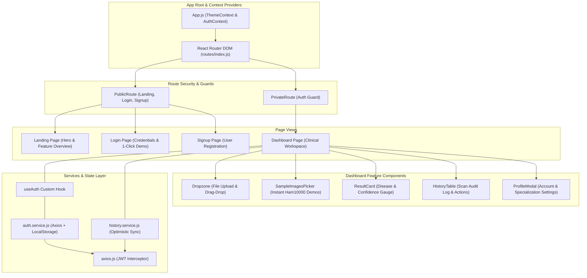

# 🎨 Frontend Architecture & State Management

> **Technical documentation for the React 18 single-page application, component hierarchy, custom hooks, context providers, routing guards, and optimistic UI caching.**

---

## 🏗️ Architectural Overview

The frontend is a modern **React 18 Single-Page Application (SPA)** designed for high diagnostic clarity, responsiveness, and resilient offline/demo usability. It employs a modular feature-component layout, centralized API services with Axios interceptors, custom hooks for encapsulated business logic, and CSS custom properties for instant dark/light theming.



---

## 📁 Directory Structure Breakdown

```
frontend/src/
├── App.js                   # Application root with context wrapper
├── index.js                 # React 18 createRoot entrypoint
├── index.css                # Global CSS reset & base typography
├── assets/                  # Static icons, logos, and illustration assets
├── components/
│   ├── common/              # Reusable atoms (Button, Card, Input, Loader, Modal, Toast)
│   ├── features/            # Feature molecules (Dropzone, ResultCard, HistoryTable)
│   └── layout/              # Structural components (Navbar, Sidebar, Footer)
├── config/                  # Environment config resolver
├── constants/               # API endpoints, routes, localStorage keys, sample images
├── context/
│   ├── AuthContext.js       # Global authentication state provider
│   └── ThemeContext.js      # Global dark/light theme state provider
├── hooks/
│   ├── useAuth.js           # Encapsulated authentication hook
│   ├── useTheme.js          # Theme selector & toggle hook
│   └── useNotification.js   # Toast notification dispatch hook
├── pages/
│   ├── Dashboard/           # Main clinical scanning workspace
│   ├── Landing/             # Public landing & feature showcase
│   ├── Login/               # Authentication & 1-Click demo portal
│   ├── Signup/              # New practitioner account creation
│   └── NotFound/            # 404 Error boundary page
├── routes/
│   ├── index.js             # Route definition map
│   └── PrivateRoute.js      # Protected route authentication guard
├── services/
│   └── api/
│       ├── axios.js         # Centralized Axios instance with request/response interceptors
│       ├── auth.service.js  # Auth API caller & demo fallback manager
│       ├── history.service.js # Optimistic scan history synchronizer
│       └── prediction.service.js # Multipart image upload service
└── styles/                  # Theme tokens and styled-component declarations
```

---

## 🔒 Routing & Access Control

The application enforces declarative route-level access control via React Router DOM v6 ([`frontend/src/routes/`](file:///d:/repos/skin_disease_detection/frontend/src/routes)):

* **Public Routes**: Accessible to all users (`/`, `/login`, `/signup`). If an authenticated user visits `/login` or `/signup`, they are automatically redirected to `/dashboard`.
* **Protected Routes (`PrivateRoute.js`)**: Requires an active JWT token or demo session. Unauthenticated attempts are redirected to `/login` with the attempted path preserved in navigation state.

---

## 🧩 Custom Hooks & State Management

### 1. `useAuth` Hook
* **File**: [`frontend/src/hooks/useAuth.js`](file:///d:/repos/skin_disease_detection/frontend/src/hooks/useAuth.js)
* **Purpose**: Provides unified access to user session state and authentication actions across all components.

```javascript
const {
  user,           // Current user profile object (or null)
  token,          // Active JWT token string
  isAuthenticated,// Boolean derived from token presence
  loading,        // Boolean indicating ongoing auth operation
  error,          // Error message string from last auth action
  login,          // async (email, password) => Promise
  demoLogin,      // async () => Promise (1-click demo entry)
  register,       // async (userData) => Promise
  logout,         // () => void (cleans token, user, redirects)
  updateProfile   // async (settings) => Promise
} = useAuth();
```

---

### 2. `useTheme` & Theme Context
* **File**: [`frontend/src/context/ThemeContext.js`](file:///d:/repos/skin_disease_detection/frontend/src/context/ThemeContext.js)
* **Purpose**: Manages dark mode / light mode state, updating HTML data-attributes and saving preference to `localStorage`.

```javascript
const { isDarkMode, toggleTheme } = useTheme();
```

---

## 🌐 API Interceptors & Fault-Tolerant Services

### Centralized Axios Instance ([`axios.js`](file:///d:/repos/skin_disease_detection/frontend/src/services/api/axios.js))
* **Request Interceptor**: Automatically attaches `Authorization: Bearer <TOKEN>` to all outgoing requests if a token exists in `localStorage`.
* **Response Interceptor**: Intercepts `401 Unauthorized` responses, clears invalid session tokens from `localStorage`, and triggers a graceful redirect to `/login`.

### Optimistic History Synchronization ([`history.service.js`](file:///d:/repos/skin_disease_detection/frontend/src/services/api/history.service.js))
1. **Immediate Local Persistence**: On receiving a prediction result, `historyService.recordScan(result)` writes the scan to `localStorage` immediately, giving the user instant UI feedback.
2. **Server Merging**: When fetching history via `getHistory()`, the service pulls MongoDB records, merges them with local records, deduplicates by `_id`, and updates the local cache.
3. **Offline Fallback**: If the backend connection drops, the service gracefully serves cached historical scans from `localStorage`.

---

## 🔗 Cross References
* [System Architecture (`system-architecture.md`)](./system-architecture.md)
* [Database & Data Models (`data-models.md`)](./data-models.md)
* [REST API Reference (`../api-reference/endpoints.md`)](../api-reference/endpoints.md)
