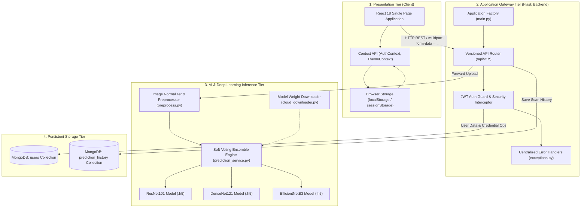
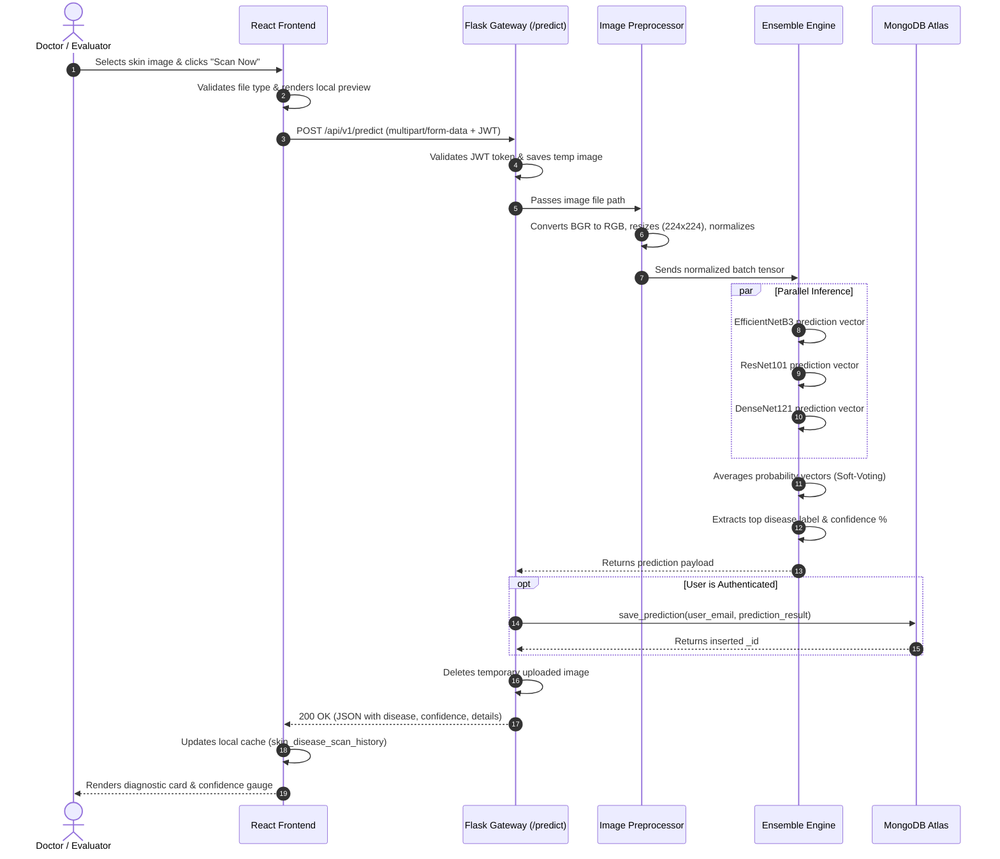
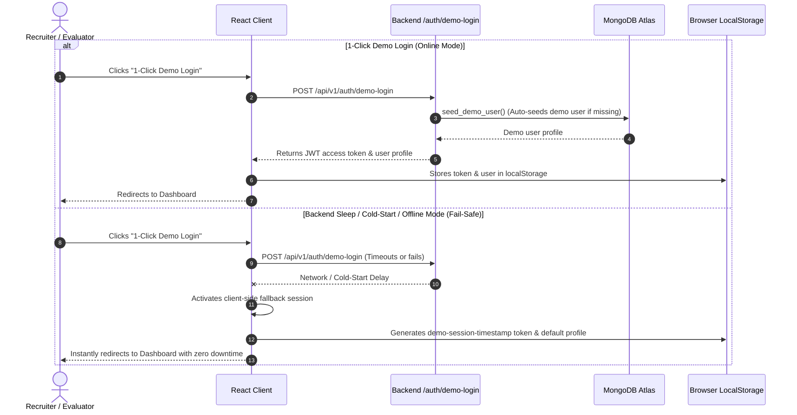

# 🏛️ System Architecture & Engineering Design

> **Deep-dive technical specification of the multi-tier architecture, system context, component dependencies, and end-to-end data flows.**

---

## 📐 High-Level Architectural Overview

The Skin Disease Detection platform is structured as a **decoupled, multi-tier microservice-friendly architecture**. It enforces a strict separation of concerns among the user presentation layer, the application gateway, the deep learning inference engine, and persistent storage tiers.

---

## 🧱 Architectural Layers Breakdown

### 1. Presentation Tier (Frontend Web Client)
* **Technology**: React 18, React Router v6, Styled Components, Axios.
* **Responsibilities**:
  * Provides intuitive clinical dermoscopy upload interfaces (drag-and-drop, sample lesion picker, camera input).
  * Manages global client state using React Context ([`AuthContext`](file:///d:/repos/skin_disease_detection/frontend/src/context/AuthContext.js), [`ThemeContext`](file:///d:/repos/skin_disease_detection/frontend/src/context/ThemeContext.js)).
  * Implements **Optimistic UI updates** and **Offline Fail-Safe Caching** through `localStorage` to guarantee 100% demo availability.
  * Formats diagnostic confidence scores, disease classifications, and clinical guidance data for medical evaluators.

### 2. Gateway & API Tier (Flask Application Layer)
* **Technology**: Python 3.12, Flask, Flask-JWT-Extended, Flask-Bcrypt, Flask-CORS.
* **Responsibilities**:
  * **Application Factory Pattern** ([`main.py`](file:///d:/repos/skin_disease_detection/backend/main.py)): Dynamically builds the Flask app with configured middleware, CORS origins, file size ceilings (16 MB), and error boundaries.
  * **Modular Route Blueprinting** ([`backend/app/api/router.py`](file:///d:/repos/skin_disease_detection/backend/app/api/router.py)): Isolates route definitions across `/auth`, `/predict`, `/history`, and `/health`.
  * **Domain Exception Interceptors** ([`backend/app/core/exceptions.py`](file:///d:/repos/skin_disease_detection/backend/app/core/exceptions.py)): Catches model failures, invalid image dimensions, and authorization rejections, serializing them into predictable JSON error responses.

### 3. Machine Learning Inference Tier (Computer Vision Engine)
* **Technology**: TensorFlow 2.x, Keras, OpenCV (`cv2`), Albumentations, NumPy.
* **Responsibilities**:
  * **Lazy Model Loading** ([`prediction_service.py`](file:///d:/repos/skin_disease_detection/backend/app/services/prediction_service.py)): Prevents slow application startup by loading TensorFlow `.h5` model graphs into memory only upon the first prediction request.
  * **Automated Cloud Weights Recovery** ([`cloud_downloader.py`](file:///d:/repos/skin_disease_detection/backend/app/ml/cloud_downloader.py)): Detects missing weight files in `trained_models/` and downloads required neural network checkpoints from remote cloud storage at runtime.
  * **Soft-Voting Ensemble Inference**: Computes class probability vectors across all three neural architectures simultaneously and calculates consensus probabilities.

### 4. Persistence Tier (Data Layer)
* **Technology**: MongoDB Atlas / Local MongoDB, PyMongo driver.
* **Responsibilities**:
  * **User Management** ([`backend/app/models/user.py`](file:///d:/repos/skin_disease_detection/backend/app/models/user.py)): Stores user identity records, salted Blowfish password hashes, roles, and profile preferences.
  * **Diagnostic Audit Log** ([`backend/app/models/history.py`](file:///d:/repos/skin_disease_detection/backend/app/models/history.py)): Stores timestamped records of predicted diseases, confidence metrics, and associated image filenames indexed by user email.

---

## 🔄 End-to-End Sequence & Data Flows

### A. Skin Lesion Prediction Lifecycle
The following sequence diagram outlines what happens when an authenticated user uploads a lesion image:

---

### B. Authentication & Fail-Safe Demo Workflow
The platform features a **Dual-Mode Authentication Architecture** supporting both real database accounts and instant zero-latency demo accounts:

---

## 🔗 Related Documentation
* [Frontend Architecture (`frontend-architecture.md`)](./frontend-architecture.md)
* [Database & Data Models (`data-models.md`)](./data-models.md)
* [Machine Learning Pipeline (`../machine-learning/ml-pipeline.md`)](../machine-learning/ml-pipeline.md)
* [REST API Reference (`../api-reference/endpoints.md`)](../api-reference/endpoints.md)
