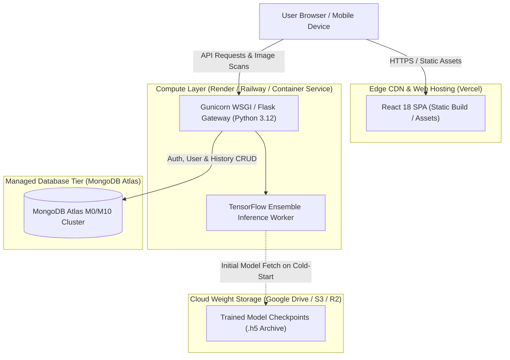

# 🚀 Production Deployment & Infrastructure Guide

> **Production deployment specifications, cloud platform configurations (Vercel, Render, Railway, MongoDB Atlas), and architecture topology.**

---

## 🌐 Production Topology



---

## ☁️ Cloud Platform Deployment Recipes

### Recipe 1: Frontend Deployment on Vercel
1. Sign in to [Vercel](https://vercel.com) and click **"Add New Project"**.
2. Connect your GitHub repository: `skin_disease_detection`.
3. Configure Project Settings:
   * **Root Directory**: `frontend`
   * **Framework Preset**: `Create React App`
   * **Build Command**: `npm run build`
   * **Output Directory**: `build`
4. Add Environment Variable in Vercel Dashboard:
   ```env
   REACT_APP_API_URL=https://<your-backend-service>.onrender.com
   ```
5. Click **"Deploy"**.

---

### Recipe 2: Backend Deployment on Render / Railway
1. Create a new **Web Service** on [Render](https://render.com) or [Railway](https://railway.app).
2. Point to the `backend` directory or root repository using Docker.
3. Configure start command:
   ```bash
   gunicorn -w 2 -b 0.0.0.0:$PORT "main:create_app()"
   ```
4. Set Environment Variables:
   ```env
   FLASK_SECRET_KEY=generate_a_random_64_character_hex_string
   JWT_SECRET_KEY=generate_another_random_64_character_hex_string
   MONGO_DB_URI=mongodb+srv://<db_user>:<db_password>@cluster0.xxxxx.mongodb.net/skin_disease_db?retryWrites=true&w=majority
   MONGO_DB_NAME=skin_disease_db
   CORS_ORIGINS=https://your-frontend.vercel.app
   MODEL_ZIP_URL=https://drive.google.com/uc?export=download&id=1kzUcTDnaL3297BWEJfnrTtvQhejAeEHa
   ```

---

### Recipe 3: MongoDB Atlas Cloud Setup
1. Create a free **M0 Cluster** at [MongoDB Atlas](https://www.mongodb.com/cloud/atlas).
2. Create a Database User with read/write privileges (e.g. `skin_admin`).
3. Under **Network Access**, add IP `0.0.0.0/0` (Allow Access from Anywhere).
4. Copy the connection string into `MONGO_DB_URI`.

---

## 🔗 Cross References
* [Docker & Containerization (`docker-and-containerization.md`)](./docker-and-containerization.md)
* [Environment Variables Reference (`environment-variables.md`)](./environment-variables.md)
* [Diagnostics & Cold-Start Troubleshooting (`../troubleshooting/diagnostic-playbook.md`)](../troubleshooting/diagnostic-playbook.md)
