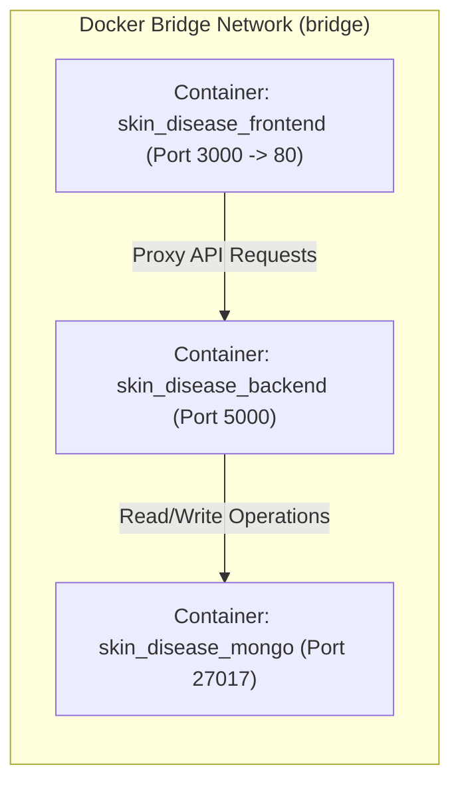

# 🐳 Docker Containerization & Orchestration

> **Technical specification for the multi-stage Docker builds, image optimizations, and Docker Compose local orchestration.**

---

## 🏗️ Container Stack Architecture

The application is containerized across three isolated network services coordinated via [`docker-compose.yml`](file:///d:/repos/skin_disease_detection/docker-compose.yml):



---

## 📦 Dockerfile Breakdown

### 1. Backend Dockerfile (`backend/Dockerfile`)
```dockerfile
FROM python:3.12-slim

ENV PYTHONUNBUFFERED=1 \
    DEBIAN_FRONTEND=noninteractive

WORKDIR /app

# Install system dependencies required for OpenCV
RUN apt-get update && apt-get install -y --no-install-recommends \
    libgl1 \
    libglib2.0-0 \
    libgomp1 \
    curl \
    && rm -rf /var/lib/apt/lists/*

COPY backend/requirements.txt requirements.txt
RUN pip install --no-cache-dir -r requirements.txt

COPY backend/ .
COPY trained_models /app/trained_models

EXPOSE 5000
CMD ["python", "main.py"]
```

### 2. Frontend Dockerfile (`frontend/Dockerfile`)
```dockerfile
# Stage 1: Build React Assets
FROM node:20-alpine AS builder
WORKDIR /app
COPY package*.json ./
RUN npm ci
COPY . .
RUN npm run build

# Stage 2: Serve via Nginx
FROM nginx:alpine
COPY --from=builder /app/build /usr/share/nginx/html
EXPOSE 80
CMD ["nginx", "-g", "daemon off;"]
```

---

## ⚡ Execution Commands

```bash
# Build and run all services in detached mode
docker-compose up -d --build

# View backend container logs
docker-compose logs -f backend

# Stop all containers
docker-compose down
```

---

## 🔗 Cross References
* [Production Deployment (`deployment-guide.md`)](./deployment-guide.md)
* [Environment Variables Reference (`environment-variables.md`)](./environment-variables.md)
* [Troubleshooting (`../troubleshooting/diagnostic-playbook.md`)](../troubleshooting/diagnostic-playbook.md)
