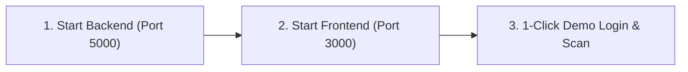

# ⚡ 5-Minute Quickstart & Verification Guide

> **Get the Skin Disease Detection platform up and running in under 5 minutes.**

---

## 🎯 Objective

Verify that all three foundational layers (React Frontend, Flask Backend, and TensorFlow Inference Engine) are properly connected and operational.

---

## ⏱️ 3-Step Express Setup



### Step 1: Launch Backend
```bash
# Terminal 1
cd backend
python -m venv venv
# Windows:
.\venv\Scripts\activate
# Linux / macOS:
# source venv/bin/activate

pip install -r requirements.txt
python main.py
```
> Verify: `http://localhost:5000/health` should return `{"status": "healthy"}`.

---

### Step 2: Launch Frontend
```bash
# Terminal 2
cd frontend
npm install
npm start
```
> Verify: Browser will automatically open `http://localhost:3000`.

---

### Step 3: Test 1-Click Recruiter Demo
1. On `http://localhost:3000/login`, click the **"1-Click Demo Login"** button.
2. You will be redirected to the **Clinical Dashboard**.
3. Under the **Sample Lesions** section, click on any pre-loaded image (e.g. *Melanoma Sample*).
4. Click **"Analyze Image"**.
5. Confirm that:
   * Probability score & confidence gauge render.
   * Disease details card shows classification info.
   * Scan history updates instantly under **Recent Scans**.

---

## 🔗 Cross References
* [Full Step-by-Step Installation (`setup-and-installation.md`)](./setup-and-installation.md)
* [System Architecture Overview (`../architecture/system-architecture.md`)](../architecture/system-architecture.md)
* [Diagnostics Playbook (`../troubleshooting/diagnostic-playbook.md`)](../troubleshooting/diagnostic-playbook.md)
