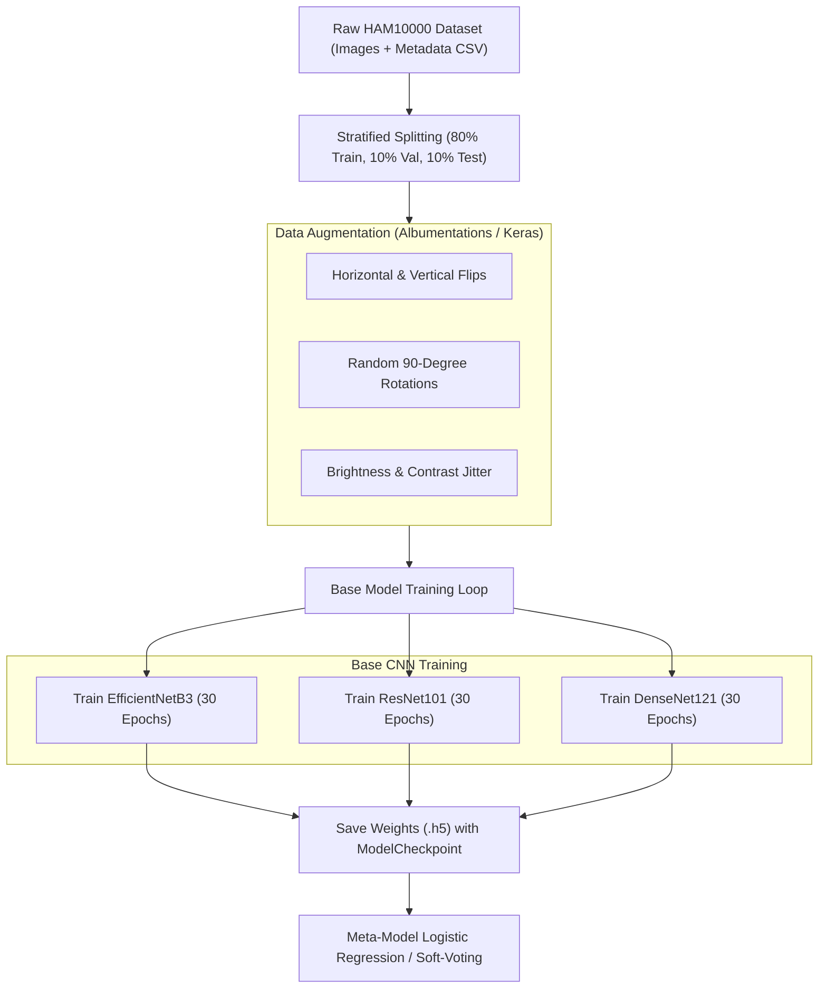

# 🏋️ Model Training & Dataset Preparation Guide

> **Deep-dive technical guide for reproducing model training from scratch using the Jupyter notebooks, dataset preparation scripts, and hyperparameter configurations.**

---

## 📁 Related Source Files & Notebooks

* [`notebooks/dataset_inspection.ipynb`](file:///d:/repos/skin_disease_detection/notebooks/dataset_inspection.ipynb) &mdash; Exploratory data analysis, class balance histograms, and dermoscopy image visualization.
* [`notebooks/model_training.ipynb`](file:///d:/repos/skin_disease_detection/notebooks/model_training.ipynb) &mdash; Full training loops for EfficientNetB3, ResNet101, and DenseNet121.
* [`backend/app/ml/pipeline/trainer.py`](file:///d:/repos/skin_disease_detection/backend/app/ml/pipeline/trainer.py) &mdash; Production training engine class (`ModelTrainer`).

---

## 🔄 End-to-End Training Lifecycle



---

## 🎛️ Hyperparameters & Training Configuration

| Parameter | Configuration | Rationale |
| :--- | :--- | :--- |
| **Input Dimensions** | `(224, 224, 3)` | Standard resolution balancing spatial details with memory footprint. |
| **Batch Size** | `32` | Optimal for modern GPUs (RTX 3080/4090 / T4) avoiding OOM. |
| **Optimizer** | `Adam(learning_rate=1e-4)` | Stable convergence with adaptive learning rates. |
| **Loss Function** | `categorical_crossentropy` | Standard multi-class classification loss across 7 mutually exclusive classes. |
| **Class Weighting** | `compute_class_weight('balanced', ...)` | Crucial for countering extreme imbalance (e.g. `nv` vs `df`). |
| **Max Epochs** | `30` per model | Controlled with `EarlyStopping(patience=6, restore_best_weights=True)`. |
| **LR Scheduler** | `ReduceLROnPlateau(factor=0.2, patience=3)` | Decays learning rate when validation loss plateaus. |

---

## 🧪 Training Execution Commands

To execute the training pipeline programmatically:

```python
from app.ml.ensemble_model import train_base_models, stack_and_train_ensemble

# 1. Train all 3 base models
base_models = train_base_models(
    train_generator=train_gen,
    val_generator=val_gen,
    class_weights=class_weights,
    epochs=30,
    save_dir="trained_models/"
)

# 2. Train stacking meta-model
meta_model = stack_and_train_ensemble(base_models, val_gen)
```

---

## 🔗 Cross References
* [ML Pipeline Overview (`ml-pipeline.md`)](./ml-pipeline.md)
* [System Architecture (`../architecture/system-architecture.md`)](../architecture/system-architecture.md)
* [Local Setup Guide (`../getting-started/setup-and-installation.md`)](../getting-started/setup-and-installation.md)
