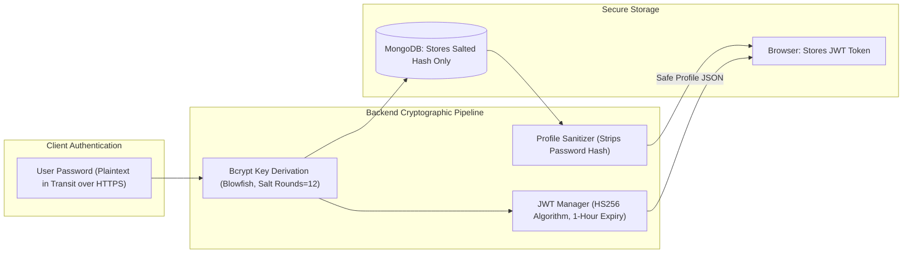

# 🔒 Security Controls, Data Privacy & Medical AI Governance

> **Security architecture, cryptographic standards, input sanitization protocols, data privacy measures, and Clinical Decision Support (CDS) regulatory notices.**

---

## 🛡️ Authentication & Cryptographic Security

### 1. Password Hashing & Salt Management
* **Algorithm**: Blowfish-based **Bcrypt** via `flask-bcrypt`.
* **Implementation**: [`backend/app/models/user.py`](file:///d:/repos/skin_disease_detection/backend/app/models/user.py#L43)
* **Design**: Raw passwords are never stored in memory or persisted to MongoDB. Each password undergoes 12 rounds of cryptographic salting and key derivation before insertion into the `users` collection.
* **Verification**: `bcrypt.check_password_hash(user["password"], password)` uses constant-time string comparison to prevent timing attacks.

### 2. JWT (JSON Web Token) Lifecycle
* **Implementation**: [`backend/main.py`](file:///d:/repos/skin_disease_detection/backend/main.py#L67-L96)
* **Access Token Expiration**: Configured to 1 hour (`timedelta(hours=1)`).
* **Refresh Token Expiration**: Configured to 30 days (`timedelta(days=30)`).
* **Claims**: The JWT payload strictly contains the normalized lowercase email as the user identity (`sub`), preventing privilege escalation attacks.
* **Revocation / Invalidation**: 401 callbacks explicitly handle `expired_token`, `invalid_token`, and `authorization_required` conditions.

### 3. Data Sanitization (`get_clean_user_profile`)
* Any document pulled from MongoDB is sanitized through `get_clean_user_profile()` before serialization.
* Strips the `password` field completely, ensuring password hashes are never exposed over network payloads or cached in client memory.

---

## 🚧 Input Validation & File Upload Hardening

### 1. Maximum Payload Size Enforcement
* **File**: [`backend/main.py`](file:///d:/repos/skin_disease_detection/backend/main.py#L54)
* **Limit**: `MAX_CONTENT_LENGTH = 16 * 1024 * 1024` (16 MB maximum upload).
* Any request attempting to flood the server with oversized image payloads is immediately rejected with HTTP `413 Payload Too Large`.

### 2. Path Traversal Prevention (`secure_filename`)
* **File**: [`backend/app/api/v1/predict.py`](file:///d:/repos/skin_disease_detection/backend/app/api/v1/predict.py#L36)
* Filenames received from client forms are scrubbed via `werkzeug.utils.secure_filename` to neutralize path traversal exploits (e.g. `../../etc/passwd`).

### 3. Ephemeral Disk Storage & Guaranteed Cleanup
* Uploaded files are written to a localized `/uploads/` scratch buffer solely for OpenCV decoding.
* **Guaranteed Deletion**: A `finally:` execution block ensures that temporary files are deleted from the disk immediately after prediction completes, preventing server storage exhaustion.

---

## ⚕️ Medical AI Regulatory Disclaimer & Governance

> [!IMPORTANT]
> **Clinical Decision Support (CDS) Notice:**
> The software, algorithms, and deep neural network models embedded within this project are developed for **academic, research, educational, and assistive screening demonstration purposes only**.

1. **Not a Diagnostic Device**: This software has not received clearance or certification as a medical diagnostic device from regulatory authorities (such as the US FDA, EU CE-MDR, or CDSCO).
2. **Physician Discretion Required**: Machine learning predictions should never be used as a standalone basis for medical diagnosis, surgical excision, biopsy deferral, or therapeutic intervention.
3. **Protected Health Information (PHI)**:
   * In enterprise production environments handling real patient records, developers must ensure compliance with HIPAA (USA) or GDPR (EU).
   * For production medical deployments, tokens should be transitioned to `HttpOnly` Secure cookies, and image storage must utilize HIPAA-compliant encrypted object stores (such as AWS S3 with KMS encryption).

---

## 🔗 Cross References
* [REST API Reference (`../api-reference/endpoints.md`)](../api-reference/endpoints.md)
* [Database & Data Models (`../architecture/data-models.md`)](../architecture/data-models.md)
* [Production Deployment (`../devops/deployment-guide.md`)](../devops/deployment-guide.md)
