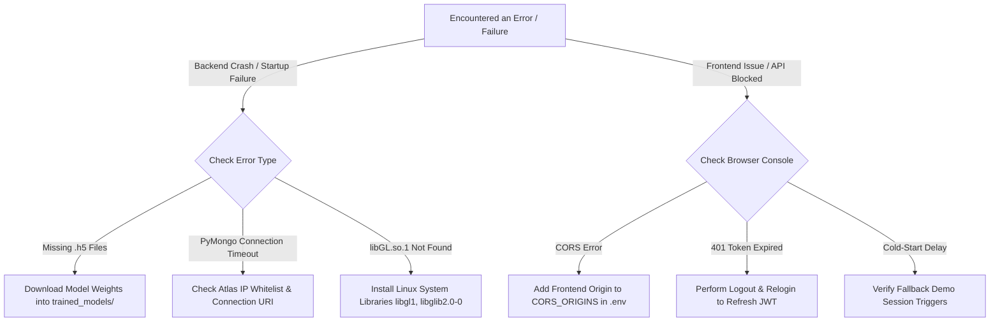

# 🔍 Troubleshooting Playbook & Diagnostic Guide

> **Structured diagnostic procedures, root cause analysis, and verified solutions for common development, runtime, and deployment issues.**

---

## 🧭 Diagnostic Decision Tree



---

## 🛠️ Common Issues & Verified Solutions

### 1. `ModelNotFoundError` &mdash; "AI models unavailable"

#### 🔴 Symptom
Inference requests fail with HTTP 500 or response payload:
```json
{ "error": "AI models unavailable. Ensure model files exist in trained_models or set MODEL_ZIP_URL." }
```

#### 🔍 Root Cause
The backend cannot locate `resnet101.h5`, `densenet121.h5`, or `efficientnetb3.h5` inside the directory specified by `MODEL_DIR`.

#### 🟢 Solution
1. Ensure the `trained_models/` directory exists in your project root:
   ```
   skin_disease_detection/
   └── trained_models/
       ├── densenet121.h5
       ├── efficientnetb3.h5
       └── resnet101.h5
   ```
2. Download the weights archive from [Google Drive Storage](https://drive.google.com/file/d/1RdJgiNy94sM2OfU3N6RqFbDBD-BawNYY/view) and extract files into `trained_models/`.
3. Or set `MODEL_ZIP_URL` in your `.env` for auto-download:
   ```env
   MODEL_ZIP_URL=https://drive.google.com/uc?export=download&id=1kzUcTDnaL3297BWEJfnrTtvQhejAeEHa
   ```

---

### 2. MongoDB Connection Timeout (`ServerSelectionTimeoutError`)

#### 🔴 Symptom
Backend fails to start or requests hang before failing with `pymongo.errors.ServerSelectionTimeoutError: No replica set members match selector`.

#### 🔍 Root Cause
* MongoDB Atlas is blocking incoming connections because the client IP is not whitelisted.
* The username/password in `MONGO_DB_URI` contains special unescaped characters or is incorrect.
* Local MongoDB daemon (`mongod`) is not running.

#### 🟢 Solution
1. **For MongoDB Atlas**:
   * Log into [MongoDB Atlas](https://cloud.mongodb.com).
   * Go to **Security &rarr; Network Access**.
   * Add IP Address: `0.0.0.0/0` (Allow Access from Anywhere).
   * Verify your database user credentials under **Database Access**.
2. **For Local MongoDB**:
   * Verify MongoDB is running locally:
     ```bash
     # Windows (Services)
     net start MongoDB

     # Linux / macOS
     sudo systemctl status mongod
     ```

---

### 3. CORS Policy Rejection on Frontend

#### 🔴 Symptom
Browser console logs:
```
Access to XMLHttpRequest at 'http://localhost:5000/predict' from origin 'http://localhost:3000' has been blocked by CORS policy.
```

#### 🔍 Root Cause
The backend's `CORS_ORIGINS` setting does not include the exact origin of the frontend application.

#### 🟢 Solution
Update `CORS_ORIGINS` in your root `.env` file to include all active frontend domains:
```env
CORS_ORIGINS=http://localhost:3000,http://127.0.0.1:3000,https://your-frontend.vercel.app
```
Restart the Flask server to reload configuration.

---

### 4. OpenCV Missing System Libraries on Linux / Docker

#### 🔴 Symptom
Backend container crashes on Linux with:
```
ImportError: libGL.so.1: cannot open shared object file: No such file or directory
```

#### 🔍 Root Cause
OpenCV requires native X11 and GL graphics libraries that are omitted in minimal Linux base images (e.g. `python:3.12-slim`).

#### 🟢 Solution
Install the necessary native packages:
```bash
# Ubuntu / Debian
sudo apt-get update && sudo apt-get install -y libgl1 libglib2.0-0 libgomp1
```

---

### 5. Cloud Provider Backend Cold-Starts (Render Free Tier)

#### 🔴 Symptom
When accessing the app after inactivity, the first API request takes 45–60 seconds to respond.

#### 🔍 Root Cause
Free-tier container hosts spin down compute instances during periods of inactivity.

#### 🟢 Built-in Platform Mitigation
* **1-Click Demo Fallback**: Clicking **"1-Click Demo Login"** activates the instant client-side demo session (`demo-session-...`) immediately, allowing reviewers to explore the UI with zero lag.
* **Keep-Alive Cron**: In production, configure an uptime monitor (such as [UptimeRobot](https://uptimerobot.com)) to ping `GET /health` every 10 minutes.

---

## 📋 Log Inspection Techniques

### Viewing Backend Logs
* **Local File**: Inspect [`backend/app.log`](file:///d:/repos/skin_disease_detection/backend/app.log).
* **Docker Logs**:
  ```bash
  docker-compose logs -f --tail=100 backend
  ```

---

## 🔗 Cross References
* [Local Setup (`../getting-started/setup-and-installation.md`)](../getting-started/setup-and-installation.md)
* [Production Deployment (`../devops/deployment-guide.md`)](../devops/deployment-guide.md)
* [REST API Reference (`../api-reference/endpoints.md`)](../api-reference/endpoints.md)
